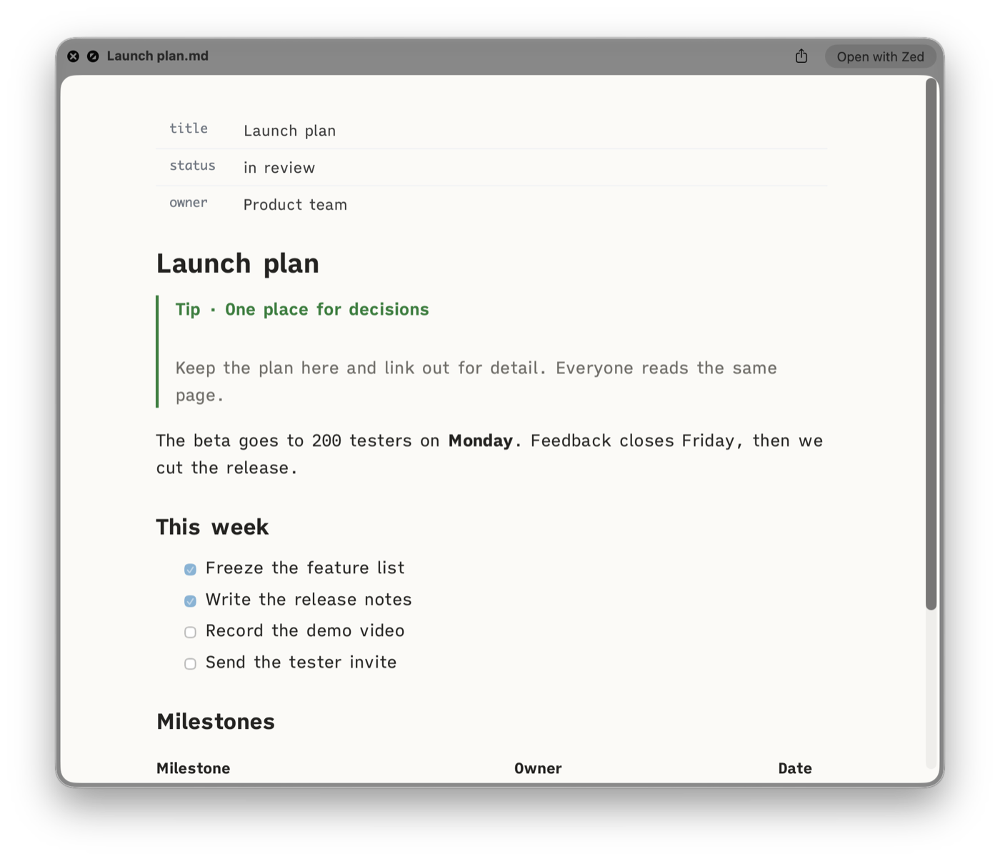
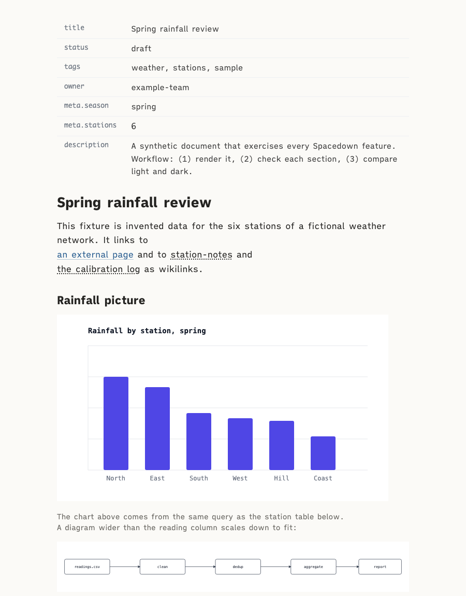
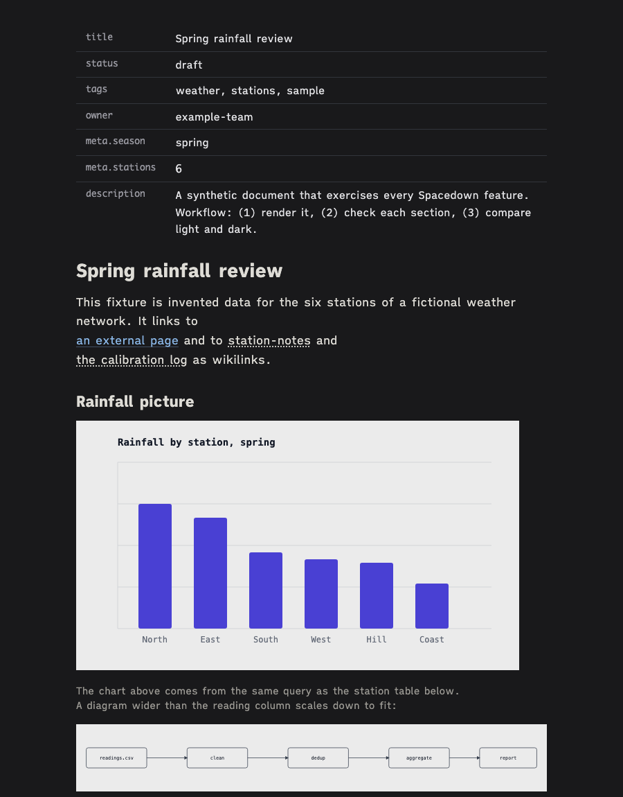
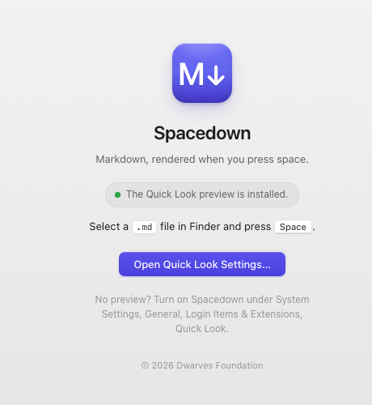

# Spacedown

[](https://github.com/dwarvesf/spacedown/releases/latest)
[](#download)
[](https://github.com/dwarvesf/homebrew-tools)
[](https://github.com/dwarvesf/spacedown/releases/latest)
[](LICENSE)

Press space on a Markdown file in Finder and read it rendered: headings, tables, code, callouts, frontmatter and LaTeX math, in a calm reading theme that follows light and dark mode.

Spacedown is a macOS Quick Look extension. It renders in-process with bundled copies of marked, KaTeX and highlight.js, so it needs no network, no pandoc and no setup beyond opening the app once.

| Part | What it does | Needs |
|---|---|---|
| `Spacedown.app` | Quick Look preview for `.md` files | macOS 13 or later |
| `spacedown` CLI | Companion renderer: Markdown to a self-contained HTML page via pandoc and KaTeX, opened in a browser; `spacedown docx` exports a `.docx` | any Unix shell, `pandoc` |
| Safari drop extension (opt-in) | Drag a `.md` file onto a Safari tab to render it with the CLI | build from source, the CLI and `pandoc` |

## Download

Get the notarized `Spacedown-<version>.dmg` (or the `.zip`) from [Releases](https://github.com/dwarvesf/spacedown/releases/latest). Open it, drag Spacedown to Applications, open it once, then select a `.md` file in Finder and press space. With Homebrew: `brew install --cask dwarvesf/tools/spacedown`. The CLI is not linked by the cask yet; see below to set it up.

## Screenshots



| Light | Dark |
|---|---|
|  |  |



## Features

- **Math.** Inline `$...$` and display `$$...$$` math rendered by KaTeX.
- **Reading themes.** An `ia` theme by default (iA Writer's Quattro look), plus `tm` (serif, from thinkingmachines.ai), `paper`, a serif `read` mode and a monospace `mono` mode.
- **Word and Google Docs export.** `spacedown docx` turns Markdown into a `.docx` in the same iA look.
- **Dark mode.** Every mode follows the system or browser appearance through `prefers-color-scheme`. There is no flag.
- **Outline sidebar.** A collapsible table of contents built from the headings, with scroll tracking. The `[` key toggles it.
- **Zoom and copy source.** `Cmd +`, `Cmd -` and `Cmd 0` scale the text. A toolbar button copies the original Markdown.
- **Reading modes.** One **Read** button in the toolbar opens a menu: Off, Skim, Bionic, BeeLine and RSVP. One mode is active at a time, and the `S` key turns the last one on or off (Skim until you pick another). The choice is remembered (RSVP is not reopened on load), and print always renders the normal view.
  - **Skim** scores every word by how unexpected it is, from an English word-frequency prior blended with a model fitted on the page itself, and fades the predictable ones. It is a port of the scoring in [skimgram](https://github.com/awesomedog/skimgram), pinned to commit 4ebb78a and checked against it token by token (`node scripts/skim-parity.mjs`). While Skim is on, the menu shows its settings, remembered like the mode: **Emphasis** (Dim, Heat, Underline; combine any, Dim by default), **Intensity** (0 to 100, default 50: how much of the page is marked) and **Score** (Auto, Surprisal or Contextual gain; Auto picks gain on pages of 600 tokens or more). A page that is not English, such as Vietnamese, is scored on its own words only. A page too short or too flat to score is left alone.
  - **Bionic** bolds the first part of each word, about 45% of its letters.
  - **BeeLine** colours each line from ink to blue, then blue to ink to red, so each line starts on the colour the one above ended on.
  - **RSVP** opens an overlay that shows one word at a time with the recognition letter in red on a centre marker. `Space` plays and pauses, the arrow keys step and change the speed (150 to 700 words per minute), `Esc` closes it. It starts from the first paragraph on screen.
- **Frontmatter as a table.** A leading YAML block renders as a key and value table. Frontmatter that strict YAML parsers reject still renders.
- **Callouts.** Obsidian-style `> [!note] Title` blocks render as styled callouts.
- **Wikilinks.** `[[target]]` and `[[target|title]]` render as links.
- **Wide tables scroll.** Tables wider than the page scroll sideways instead of squashing.
- **Relative images work.** Images resolve against the source file's folder, wherever the HTML lands.
- **Folder mode.** `spacedown <dir>` renders every top-level Markdown file and writes an index page.
- **Live reload.** `--watch` re-renders on save and refreshes the open page.
- **Editor fonts.** Font settings from VS Code or VSCodium carry over to the page (see below).

## Install the spacedown CLI

The CLI is a single bash script plus the `assets/` folder next to it. The Quick Look panel carries the same iA look as the default `ia` theme.

**With the app.** From the next release, `Spacedown.app` carries the CLI at `Contents/Resources/cli/bin/spacedown`, with the assets it needs beside it, and the cask will link it. Until then, link a source checkout (below) or, with a build that has it, link it yourself: `ln -sfn /Applications/Spacedown.app/Contents/Resources/cli/bin/spacedown ~/.local/bin/spacedown`. The Mac App Store build does not carry the CLI. `pandoc` is still required.

**From source.**

```bash
brew install pandoc        # required
brew install entr          # optional, only for --watch
# python3 is optional: it powers the frontmatter table, callouts and live reload.

git clone https://github.com/dwarvesf/spacedown.git
cd spacedown
mkdir -p ~/.local/bin
ln -sfn "$PWD/bin/spacedown" ~/.local/bin/spacedown
spacedown --version
```

The script resolves its own symlink, so `assets/` must stay next to `bin/`. Make sure `~/.local/bin` is on your `PATH`.

## Usage

```bash
spacedown notes.md                       # render and open in a browser
spacedown docx notes.md                  # Markdown to .docx (see Export below)
spacedown notes.md --no-open             # render only, print the output path
spacedown notes.md --out /tmp/page.html  # choose the output path
spacedown notes.md --watch               # re-render on save, page auto-refreshes
spacedown notes.md --font-mode read      # serif reading mode
spacedown .                              # every .md in this folder, plus an index
```

The default output path is `/tmp/spacedown/<slug>.html`, where the slug is the lowercased file name with every run of other characters turned into `-`. Rendering the same file again overwrites the same page, so a browser tab can stay open on it.

### Output contract

- **stdout** carries exactly one line on success: the absolute path of the HTML file. `open "$(spacedown notes.md --no-open)"` works.
- **stderr** carries everything else, each line prefixed with `spacedown:`.
- When stdout is not a terminal, `--no-open` is implied. Scripts and coding agents can call the tool without opening a browser.

### Flags

| Flag | Meaning |
|---|---|
| `<file>` or `<dir>` | A Markdown file, or a folder to render as an index (top level only). |
| `--out PATH` | Output HTML path. Parent folders are created. |
| `--no-open` | Do not open a browser. Implied when stdout is not a terminal. |
| `--watch` | Re-render on save (needs `entr`). With `python3`, the open page refreshes itself. Ctrl-C stops. |
| `--title STR` | Browser tab title. Default: the file name without its extension. |
| `--font-mode MODE` | `ia` (default), `tm`, `paper`, `read` or `mono`. See below. |
| `--no-standalone` | Emit an HTML fragment for embedding instead of a full page. |
| `--help`, `--version` | Print usage, or the version plus dependency status. |

### Font modes

| Mode | Look |
|---|---|
| `ia` (default) | A port of iA Writer's Quattro template: every heading at body size in bold, dash bullets, hairline table rules, near-black on `#fcfcfc` with 164% leading. Set in iA Writer Quattro and iA Writer Mono. Dark ground is iA's night `#1a1a1a`. |
| `tm` | Serif reading look with typography ported from thinkingmachines.ai (Georgia first, for full Vietnamese diacritics). Code containers are themed; syntax colors stay pandoc-tango. |
| `paper` | Warm paper ground, a modest heading scale and soft rules. Set in iA Writer Quattro and iA Writer Mono when installed, otherwise in system fonts. Carries its own dark palette. |
| `read` | Proportional serif prose (Georgia first, for full Vietnamese diacritics) with monospace code and tables. |
| `mono` | Full editor fidelity: the fonts mirrored from the editor settings, monospace everywhere. |

The iA Writer fonts are free under the SIL Open Font License 1.1. The repo vendors the four variable files (Quattro V and Mono V, upright and italic) in `assets/fonts/ia/` with their license, so the look is reproducible on any Mac. The browser themes name the fonts by family and do not embed them, so an installed copy is what a browser page uses. Install the fonts from [github.com/iaolo/iA-Fonts](https://github.com/iaolo/iA-Fonts) or by copying `assets/fonts/ia/*.ttf` into Font Book. Without them the page falls back to system fonts. The Quick Look panel does embed the vendored fonts (see below).

`assets/ia-theme.css`, `assets/tm-theme.css` and `assets/paper-theme.css` are plain CSS, so each also works as a VS Code or VSCodium [`markdown.styles`](https://code.visualstudio.com/docs/languages/markdown#_using-your-own-css) entry. Point the setting at the file with a `file://` URL and an absolute path.

### Environment variables

| Variable | Effect |
|---|---|
| `SPACEDOWN_FONT_MODE` | Default font mode when `--font-mode` is absent. Default: `ia`. |
| `SPACEDOWN_THEME_CSS` | A plain CSS file that replaces the CSS of the active `ia`, `tm` or `paper` mode. `read` and `mono` ignore it. |
| `SPACEDOWN_SETTINGS` | A `settings.json` to read preview fonts from. Default: VSCodium's, then VS Code's. |
| `SPACEDOWN_BROWSER` | App name to open pages in, for example `"Google Chrome"`. Default: the first installed of Arc, Chrome, Edge and Brave, then the system default. |

spacedown reads `markdown.preview.fontFamily`, `markdown.preview.fontSize`, `markdown.preview.lineHeight` and `editor.fontFamily` from the settings file. With no settings file, stock VS Code defaults apply.

### Exit codes

| Code | Meaning |
|---|---|
| `0` | Success |
| `1` | Source file missing, unreadable or empty |
| `2` | pandoc missing or failed |
| `3` | `--watch` requested but `entr` is not installed |
| `64` | Usage error |
| `130` | Ctrl-C during `--watch` |

## Export to Word and Google Docs: spacedown docx

```bash
spacedown docx notes.md                      # writes notes.docx next to it, prints the path
spacedown docx notes.md -o ~/Desktop/notes.docx
```

The result uses a pandoc reference doc (`assets/docx/ia-reference.docx`) that carries the iA look: ink `#1a1a1a`, 1.64 line height, headings at body size in bold, one block gap and about 70 characters per line. Frontmatter `title:` becomes the title block. HTML comments are dropped, so a private note in a comment never reaches the reader. iA Writer Quattro is not in the Google Docs font list, so the doc uses IBM Plex Sans and IBM Plex Mono, the faces iA's fonts derive from. It is a subcommand of the one `spacedown` CLI; there is no separate script. Plain `spacedown <file>` still renders HTML. A file literally named `docx` renders with `spacedown ./docx`. Exit codes: `0` ok, `2` pandoc or the reference doc missing, `64` usage, `66` input file not found.

To open it as a Google Doc, upload the `.docx` with [GAM](https://github.com/GAM-team/GAM) and ask Drive to convert it:

```bash
gam user <user> create drivefile drivefilename "<name>" localfile notes.docx mimetype gdoc
gam user <user> update drivefile <id> localfile notes.docx newfilename "<name>"   # refresh in place, keeps sharing
```

To change the look, edit the style values at the top of `scripts/build-docx-reference.py`, run `python3 -I scripts/build-docx-reference.py`, and commit the script and the regenerated `.docx` together.

## Build the app from source

The Quick Look and Safari extensions live in one app bundle, `Spacedown.app`. One script builds, signs (ad hoc) and installs it.

Requirements: Xcode (for `xcodebuild` and `swiftc`) and [XcodeGen](https://github.com/yonaskolb/XcodeGen) (`brew install xcodegen`). `node` is optional: when present, the build first runs the Quick Look render tests.

```bash
integrations/build-safari.sh                # the app with the Quick Look extension only
integrations/build-safari.sh --with-safari  # also the Safari drop extension and its render helper
```

`integrations/build-safari.sh` also copies the CLI and its assets into the app with `scripts/bundle-cli` before signing. `BUNDLE_CLI=0` leaves them out; the Mac App Store build does.

To notarize, sign with a Developer ID (`SIGN_ID`) and set `NOTARIZE=<notarytool keychain profile>`, or an App Store Connect API key with `NOTARY_KEY=<.p8 path> NOTARY_KEY_ID=<id> NOTARY_ISSUER=<issuer>` (headless, same variables as `scripts/release.sh`). Either one triggers notarization and stapling; the key wins when both are set.

| Installed item | Path | When |
|---|---|---|
| `Spacedown.app` | `~/Applications/` | always |
| Render helper (XPC) | `~/.local/libexec/spacedown-render` | `--with-safari` |
| LaunchAgent `dfoundation.spacedown.render` | `~/Library/LaunchAgents/` | `--with-safari` |
| `spacedown-open` link | `~/.local/bin/spacedown-open` | `--with-safari` |

The Quick Look panel shows the iA look. Its sandboxed webview cannot load fonts installed on the Mac, so the build runs `scripts/build-ql-skin`. That step prepends `@font-face` rules carrying the four vendored iA Writer fonts as base64 data URIs to the skin source (`integrations/safari/quick-look/Resources/ql-reading.css`) and ships the result inside the app. The committed skin stays readable. `SKIN_CSS=<file>` replaces the skin with your own, used as given and not font-embedded. `scripts/build-ql-skin [out.css]` builds the embedded skin by itself.

After the build, select a `.md` file in Finder and press space. If the preview does not appear, enable **Spacedown** under System Settings > General > Login Items & Extensions > Quick Look.

The Safari extension must be App-Sandboxed to load, and a sandboxed extension cannot run pandoc. It therefore forwards each dropped file over XPC to a small unsandboxed helper, which launchd starts on demand and which exits when idle. To enable the extension after `--with-safari`:

1. Safari > Settings > Developer: tick **Allow unsigned extensions**. An ad hoc signature counts as unsigned, and this setting resets on every Safari restart. A build signed and notarized with a Developer ID (`SIGN_ID` and `NOTARIZE`, see the header of `build-safari.sh`) skips this step; Safari does not list a Developer ID extension that is not notarized.
2. Quit and relaunch Safari.
3. Safari > Settings > Extensions: tick **Spacedown**.
4. Click the toolbar button, then drag a `.md` file onto the drop page.

`integrations/install.sh` sets up two more entry points: a Finder "Open With" app and a native-messaging host for a Chromium drop extension. See [integrations/README.md](integrations/README.md).

## Development

```bash
bash tests/smoke.sh                                   # CLI and spacedown docx suite, also runs the Quick Look tests
node scripts/skim-parity.mjs                          # Skim engine against the skimgram goldens (also part of smoke.sh); add --upstream <clone> to run skimgram live
node integrations/safari/quick-look/test-render.js    # Quick Look render core only
spacedown tests/fixture/fixture.md                   # synthetic document that exercises every feature
```

`assets/REFRESH.md` explains where the vendored VS Code stylesheet and highlight.js come from and how to refresh them.

### Releasing

The Releases page carries one release: each new version replaces the previous one.

1. Bump the version in `integrations/safari/quick-look/project.yml` (`MARKETING_VERSION`), the Xcode project (`MARKETING_VERSION`) and `bin/spacedown` (`VERSION`). Merge.
2. `scripts/release.sh` on a clean `main`: builds the Quick Look app, signs it with the Dwarves Foundation Developer ID, notarizes and staples it, builds the `.zip` and a notarized `.dmg`, and publishes the GitHub release. It then deletes the older releases and their tags. `KEEP_OLD_RELEASES=1` skips that step. It needs the Developer ID identity in the keychain and a `notarytool` keychain profile (default `DWARVES_NOTARY`); the script header lists every setting.
3. Bump `Casks/spacedown.rb` in [dwarvesf/homebrew-tools](https://github.com/dwarvesf/homebrew-tools) to the new version and the zip's sha256.
4. Mac App Store: `scripts/release.sh --mas` builds the signed store package; upload it to App Store Connect, attach the build to a new version and submit it for review.
5. App Store Connect listing and screenshots. These are separate one-off or per-release scripts, not called by `release.sh`.
   - `scripts/asc_setup.py`: one-time App Store Connect setup. Registers the app and Quick Look extension bundle ids, creates and imports the Apple Distribution and Mac Installer Distribution certificates, and saves the Mac App Store provisioning profiles. Needs the `dfoundation-prod` 1Password vault's "...Hacker Bar Release" item (Key ID, Issuer ID, private key) and `openssl`.
   - `scripts/asc_listing.py`: fills the App Store Connect listing through the API: categories, subtitle, description, keywords, age rating, price, territories, screenshots, and the processed build. Never submits for review. Needs the same 1Password item plus a metadata JSON file and screenshot PNGs as arguments.
   - `scripts/mas-altool.sh`: runs `altool` validate or upload for the signed `.pkg`, reading the API key from the same 1Password item at call time. Usage: `mas-altool.sh validate|upload <pkg>`.
   - `scripts/store-shots.sh`: renders the two App Store screenshots from the real Quick Look preview through headless Brave. Needs Brave Browser and Node. Renders the fixtures `scripts/launch.md` (light) and `scripts/showcase.md` (dark).
   - `scripts/readme-shots.sh`: renders the test fixture through the same Quick Look pipeline and screenshots it into `docs/images/` for this README. Needs Brave Browser and Node.
   - `scripts/layout-check`: renders a markdown file with `bin/spacedown`, measures the layout in a private headless Helium at 390, 768, 1470 and 1728px (overflow, content edges, side gaps, right edges, optional Skim marked-word share, optional dark palette), screenshots each width, and exits 1 when any width scrolls sideways. Needs Helium; `BROWSER` overrides it.
   - `scripts/window-shots.sh`: screenshots the app window page, Quick Look only and with Safari, light and dark, at the sizes `ViewController` sets. Needs Brave Browser.
   - `scripts/qlwrap.js`: wraps a Quick Look render body the way `MarkdownPreviewProvider.buildPreviewHTML` does. Used by `store-shots.sh` and `readme-shots.sh`. Needs Node.

## Limitations

- Pages open with `open(1)`, so browser launch is macOS only. On other systems, use `--no-open` and open the printed path yourself.
- In browser output, pandoc loads KaTeX from a CDN, so math in those pages needs a network connection. The Quick Look panel bundles KaTeX and works offline.
- The input is Markdown only.
- Release downloads are notarized. A build from source is signed ad hoc, so Gatekeeper and Safari treat it as unsigned.

## Credits

- The browser look builds on VS Code's markdown preview stylesheet (Microsoft, MIT).
- Math by [KaTeX](https://katex.org), Markdown parsing in Quick Look by [marked](https://marked.js.org), code highlighting in Quick Look by [highlight.js](https://highlightjs.org), conversion by [pandoc](https://pandoc.org).
- The `ia` and `paper` themes and the Quick Look skin use the iA Writer Quattro and iA Writer Mono typefaces, vendored under the SIL Open Font License 1.1. Fonts by Information Architects. The `ia` look ports the Quattro template of iA Writer, and the `tm` look ports the typography of thinkingmachines.ai.

Licenses for bundled third-party code are in [THIRD_PARTY_NOTICES.md](THIRD_PARTY_NOTICES.md).

## License

MIT. See [LICENSE](LICENSE). Copyright (c) 2026 Dwarves Foundation.
