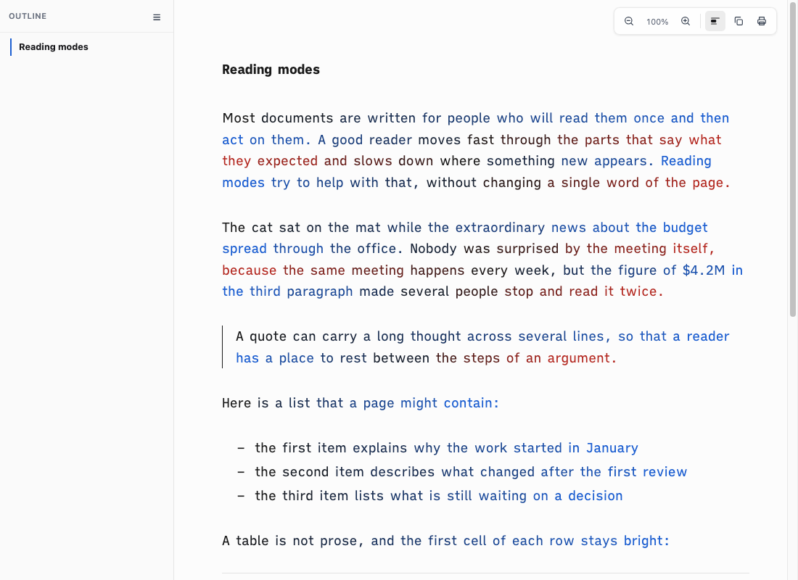
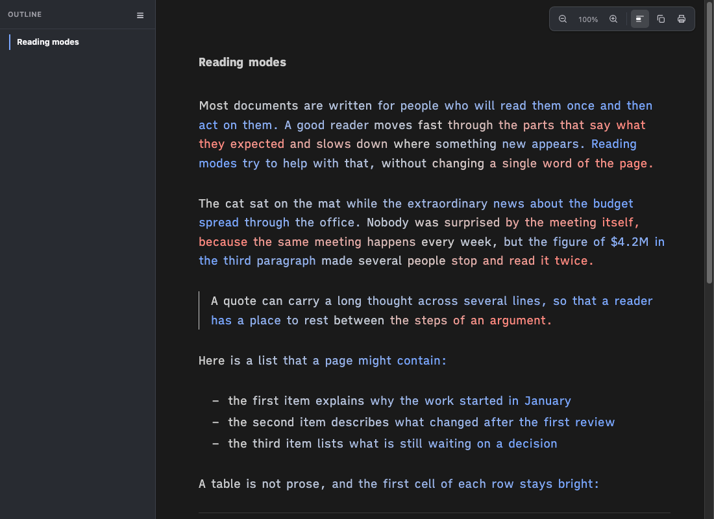
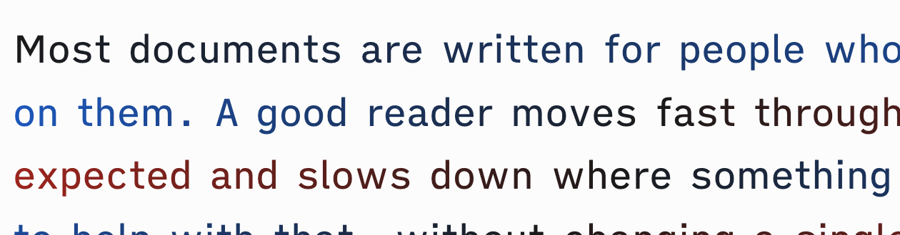
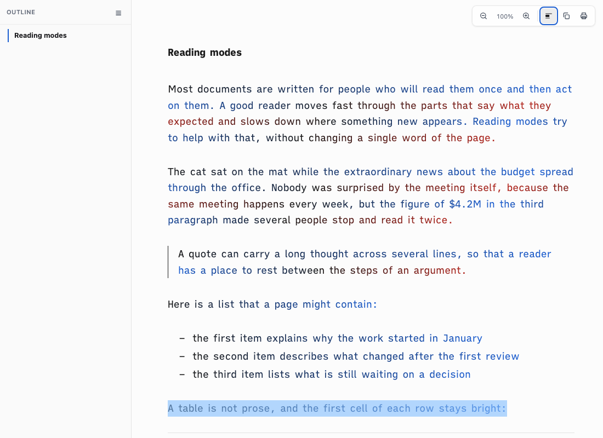

# Proof of Done, beeline-smooth

BeeLine used to set one solid colour per word, taken at the word's x position, so a line stepped from word to word. Each word span now carries its own slice of the line gradient: `--bl-g` holds a `linear-gradient(to right, ...)` from the line colour at the word's left edge to the colour at its right edge, and screen-only CSS draws it as `background-image` clipped to the text (`background-clip: text`, `-webkit-text-fill-color: transparent`). A word ends on the colour where the next word starts (only a space lies between), so neighbours join without a step. A stop that falls inside a word (the ink midpoint of lines 2 and up) is kept at its percentage. Still one span per word, no per-character spans.

| Case | Behaviour | Where it lives |
|---|---|---|
| Browser supports `background-clip: text` | Gradient slice per word; the class `sd-bl-g` is added only when the slice was computed | foot (colours, layout pass), head (`@supports` block) |
| No `background-clip: text` | Today's solid per-word colour (`sd-bl-*` classes and `--bl-a`) | head |
| `forced-colors: active` | Gradient off, normal text colour | head |
| Print | Unchanged: every BeeLine rule and the `--bl-g` drawing sit inside `@media screen` | head |
| Selected text | `::selection` gives the word a solid fill, so it stays readable over the highlight | head |
| Resize, late font, theme change | Layout pass reruns (debounced 150 ms) and recomputes the slices from the resolved ink, blue and red | foot |
| Off or another mode | `restoreText()` puts the original text nodes back; the spans and their style go with them | foot |

Links, bold, code and headings are not BeeLine words (as before), so they keep their own colour. Italic words are plain spans inside `em`; a scratch page with `*italic phrase*` showed all five `EM` words with the gradient and a clear text fill.

## Green run

| Command | Exit | Verdict |
|---|---|---|
| `bash tests/smoke.sh` | 0 | PASS, 110 checks |

```
[read-12] BeeLine colours each line: ink to blue, then blue to ink to red, each line starting on the colour the last one ended on
  ok: word spans, first word on the ink, line ends meet the next line starts, middle of a line is ink
[read-12b] BeeLine is smooth: every word paints its own linear-gradient slice, clipped to the text, and neighbours meet at the same colour
  ok: linear-gradient background on every word, background-clip text, clear text fill, no flat word, seams under 3 channel units
[read-14] switching through every mode never stacks markup; Off restores the original text exactly; S brings the last mode back
  ok: one class at a time, zero leftover spans, text and node count identical to the load state
smoke: all 110 passed
```

What the driver measured on the English fixture, last paragraph (headless Helium, 1000 by 500, `ia` theme):

| Measure | Value |
|---|---|
| Words with a computed `linear-gradient` background | 69 of 69 |
| Words with `background-clip: text` and a clear text fill | 69 of 69 |
| Neighbouring word pairs on a line compared | 61 |
| Largest channel difference, word N right colour vs word N+1 left colour | 0 |
| Words 40px or wider whose left and right colours are equal ("flat") | 0 of 37 |
| Line end vs next line start, largest channel difference | 0 |
| Pairs separated by a link or bold word (not compared) | skipped, gap over 10px |

The Off check (`read-14`) now also counts any `sd-bl-g` class or `--bl-` style left behind; both are 0, and the page text and text-node count equal the load state.

## Visual check

Headless Helium, 1100 by 800, `ia` theme, English fixture. Dark is applied by promoting the `prefers-color-scheme: dark` blocks to `all`.

| | Before | After |
|---|---|---|
| Light |  |  |
| Dark |  |  |

Three times zoom on the first lines, light (colour changes inside words, not only between them):



A selected paragraph stays readable over the highlight:



`reading-modes/beeline-light.png` and `reading-modes/beeline-dark.png` are refreshed to the new look.

## Negative control

Committed first (`fix(chrome): BeeLine paints a smooth gradient inside each word`), then in `assets/reading-chrome-foot.html` the right stop of each slice was set to the left stop (every word a flat colour again, the old stepped look). Restored with `git checkout --` and the suite re-run green.

| Break | Checks that went red | Result line |
|---|---|---|
| Right stop of each slice set to the left stop | `read-12`, `read-12b` | `smoke: 108 passed, 2 FAILED` |

```
  FAIL: beeline gradient or continuity wrong
  FAIL: beeline words are not smooth gradient slices, or neighbouring words do not meet
smoke: 108 passed, 2 FAILED
```

After `git checkout -- assets/reading-chrome-foot.html`: `smoke: all 110 passed`.

## Reproduce

```bash
bash tests/smoke.sh      # the BeeLine checks need a Chromium-family browser; SPACEDOWN_TEST_BROWSER names one
./bin/spacedown tests/fixture/reading-en.md --out /tmp/en.html --no-open && open /tmp/en.html   # Read menu, BeeLine
```

## Known limits

- The slice ends where the next word starts, so a word's gradient stretches over its width plus one space; the shift is under one space width.
- A link, bold or code word between two BeeLine words is not a span, so the colour jumps across it as before.
- A browser that does not resolve `var()` colours to `rgb()` or `color(srgb ...)` keeps the solid per-word colour for that word.

## Rollback

Revert the commits of this branch. Nothing is stored; the solid per-word colour code is still in place as the fallback.
