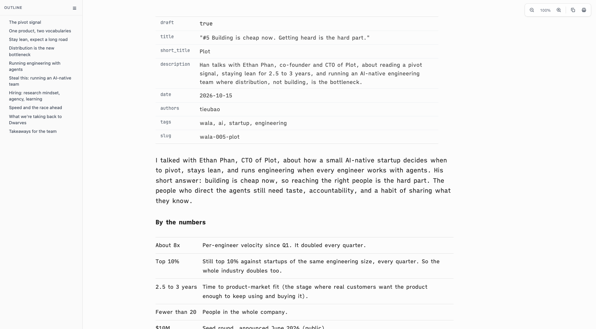

# Proof of Done, center-reading-column

The body capped at 60rem while prose, tables and rules cap at the 48rem measure. The extra 12rem sat as an empty strip right of the text, so the column looked off center. The body is now the 48rem measure itself; wide tables and code scroll inside it.

## Green run

| Command | Exit | Verdict |
|---|---|---|
| `bash tests/smoke.sh` | 0 | PASS |

```
[13] page column overrides pandoc default
  ok: 48rem page column wins over pandoc 36em
smoke: all 85 passed
```

Space between the outline sidebar and the content (left) and between the content and the window edge (right), headless Helium, WALA #5 article, no horizontal page scroll in any run:

| window | before left / right | after left / right |
|---|---|---|
| 1470px | 71 / 273 | 179 / 165 |
| 1728px | 200 / 402 | 308 / 294 |

| before (1728px) | after (1728px) |
|---|---|
|  |  |

## Negative control

The prior `assets/vscode-preview-head.html` restored over the fix, same suite:

```
  FAIL: page column / prose measure missing or ordered before pandoc default
smoke: 84 passed, 1 FAILED
```

## Rollback

Revert this squash commit to return to the 60rem page column.
