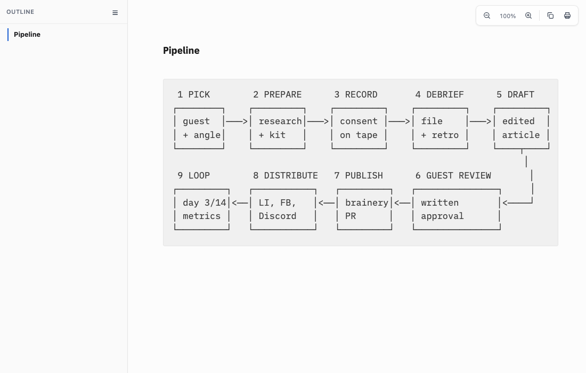
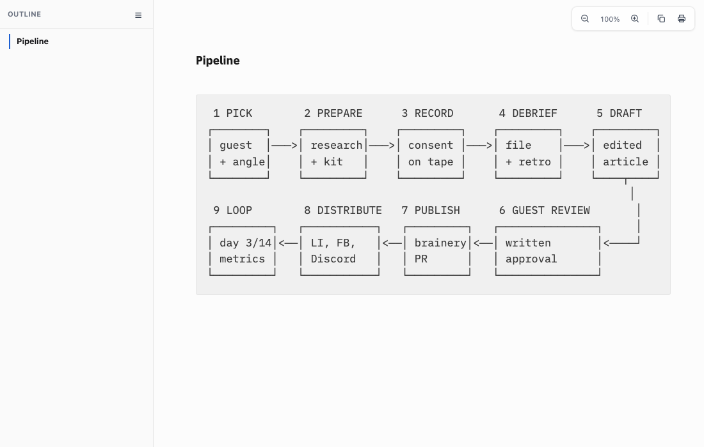

# Proof of Done, ia-diagram-align

In `--font-mode ia`, ASCII diagrams in code blocks misaligned: the vertical bars drifted on lines that carry `───>` arrows. iA Writer Mono has no box-drawing glyphs, so each `─ │ ┌ ┐ └ ┘ ┬` fell back to Menlo, whose advance is 0.60205em against iA Mono's 0.6em. A line of 50 fallback glyphs ran about 2px wide, and lines with fewer of them did not. A `local("Menlo")` face with `size-adjust: 99.6594%`, limited to arrows and box drawing and listed right after iA Mono in the stack, makes the fallback exactly 0.6em. The same fix applies to the `paper` theme, which uses the same stack.

## Green run

| Command | Exit | Verdict |
|---|---|---|
| `bash tests/smoke.sh` | 0 | PASS |

```
[diagram] box drawing keeps iA Mono's advance (its font lacks those glyphs; a fallback one drifts the bars)
  ok: box-drawing fallback sized to 0.6em in ia and paper
smoke: all 74 passed
```

Glyph coverage of `assets/fonts/ia/iAWriterMonoV.ttf` (fontTools) for the non-ASCII characters of the WALA "Pipeline" block:

| Characters | Codepoints | In iA Mono V |
|---|---|---|
| `─ │ ┌ ┐ └ ┘ ┬` | U+2500, 2502, 250C, 2510, 2514, 2518, 252C | missing (0 of 128 in U+2500 to U+257F) |
| `>` `<` and letters | ASCII | present, advance 600/1000 |

Menlo advance for the same glyphs: 1233/2048 = 0.60205em. At the 16.92px code size: 10.152px (iA Mono) against 10.188px (Menlo).

Measured in headless Helium on the "Pipeline" block of `wala/README.md`, x of each `│` from the left of the `pre` (Range.getClientRects per character):

| | line `│ guest │───>│` | line `│ + angle│    │` | last `┐` on the `┌───┐` row | spread of the last bar |
|---|---|---|---|---|
| before | 702.31 / 701.20 | 700.78 | 702.31 | 1.53px |
| after | 700.44 | 700.45 | 700.41 | 0.04px |

Per-line advance (right edge divided by character count), all 11 lines:

| | min | max | spread |
|---|---|---|---|
| before | 10.152 | 10.182 | 0.030 |
| after | 10.151 | 10.152 | 0.001 |

The 0.04px left over is the browser's 1/64px layout quantization, not a font difference. Every line now has one character advance.

| before | after |
|---|---|
|  |  |

## Negative control

The prior `assets/ia-theme.css` and `assets/paper-theme.css` restored over the fix (`git show HEAD~1:<path>`), same suite:

```
  FAIL: box-drawing glyphs fall back to a font with another advance: diagram bars drift
smoke: 73 passed, 1 FAILED
```

Restored with `git checkout -- assets`, suite back to `smoke: all 74 passed`.

## Limits

The fix needs Menlo, so it covers macOS (Chrome, Safari, Quick Look). Other platforms keep the old fallback and the old drift. The smoke test checks the CSS contract; the pixel numbers above come from the headless measurement.

## Rollback

Revert this squash commit.
