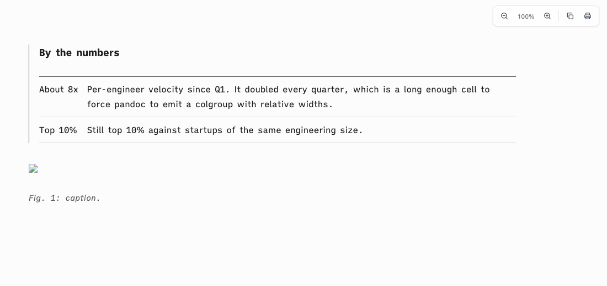
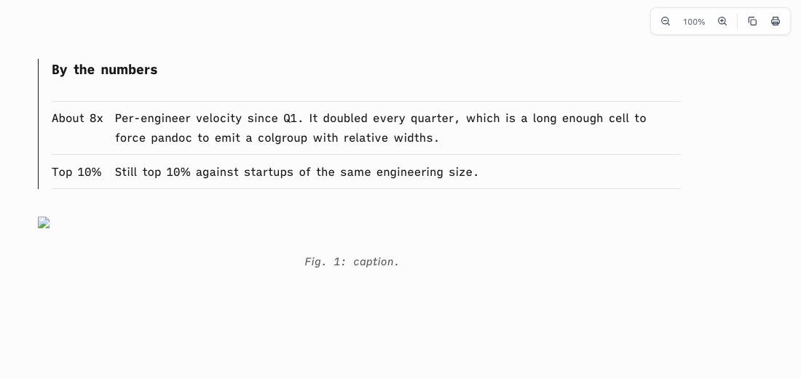

# Proof of Done, ia-headless-table-rule

A headless table (`| | |` over the rule row) with long cells opened on a black ink rule in ia mode. Pandoc puts a colgroup before the tbody, so the first-row soft rule keyed on `tbody:first-child` never matched, and pandoc's default `tbody { border-top: 1px solid #1a1a1a }` showed through. The ia theme now clears the tbody borders and keys the first-row rule on `tbody:first-of-type`. Captions under a lone image are now centered.

## Green run

| Command | Exit | Verdict |
|---|---|---|
| `bash tests/smoke.sh` | 0 | PASS |

```
[ia-table-headless] a headless table behind a colgroup opens on a soft rule, not pandoc's ink tbody rule
  ok: headless table top rule
[ia-caption] a caption under a lone image is centered
  ok: centered caption
smoke: all 70 passed
```

Computed styles in headless Helium, on a quoted headless table with a colgroup:

| | tbody top border | first row top border | caption align |
|---|---|---|---|
| before | `rgb(26, 26, 26) solid` | none | start |
| after | none | `rgb(227, 227, 227) solid` | center |

| before | after |
|---|---|
|  |  |

## Negative control

The prior `assets/ia-theme.css` restored over the fix, same suite:

```
  FAIL: headless table: tbody ink rule not undone, or first-row rule still keyed on tbody:first-child
  FAIL: caption not centered
smoke: 68 passed, 2 FAILED
```

## Rollback

Revert this squash commit.
