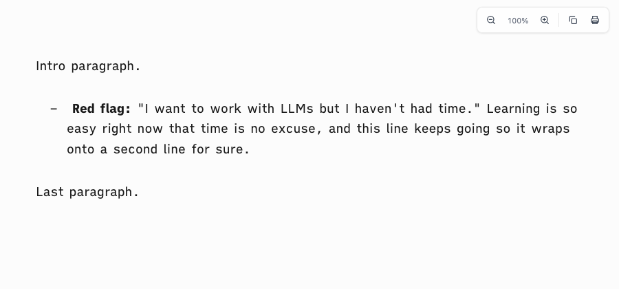
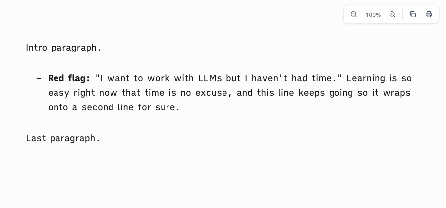

# Proof of Done, ia-list-hang-page-end

The ia dash marker was three characters wide (`– ` plus two no-break spaces) but pulled back only 1.35em, so the first line of a bullet sat right of its wrapped lines. The marker is now one dash with a width equal to its pull-back, so it takes no room and wrapped lines hang under the text. The page also gets 6em of bottom padding (it had none), so the last line clears overlays and the window edge.

## Green run

| Command | Exit | Verdict |
|---|---|---|
| `bash tests/smoke.sh` | 0 | PASS |

```
[ia-list-hang] the dash marker takes no room, so wrapped bullet lines align under the text
  ok: list hang
[page-end] the page leaves room below the last line
  ok: bottom padding
smoke: all 72 passed
```

Measured in headless Helium on a wrapped bullet (first-line text left minus last-line text left, and the body's computed bottom padding):

| | hang offset | body padding-bottom |
|---|---|---|
| before | 8.1px | 0px |
| after | 0.0px | 108px |

| before | after |
|---|---|
|  |  |

## Negative control

The prior `assets/ia-theme.css` and `assets/vscode-preview-head.html` restored over the fix, same suite:

```
  FAIL: dash marker is wider than its pull-back: wrapped bullet lines start left of the first line
  FAIL: no bottom padding on the page
smoke: 70 passed, 2 FAILED
```

## Rollback

Revert this squash commit.
