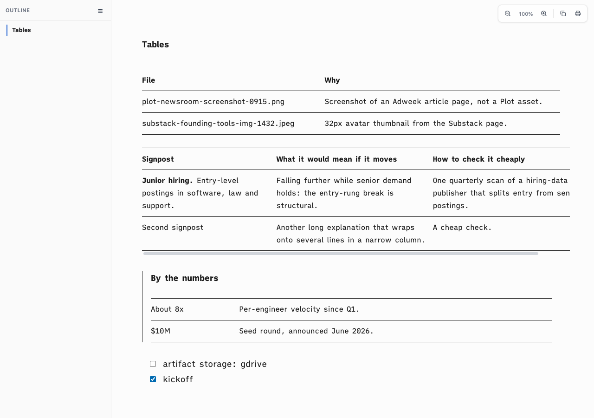

# Proof of Done, ia-table-fidelity

Tables in the `ia` mode drifted from iA Writer: a bold first column, light grey row rules, and top and bottom rules on the table box that ran past the cells. They now follow iA Writer: ink hairlines at the top, under the header, between rows and at the bottom, body-weight cells, and the rules sit on the cells.

**Date:** 2026-10-16 · **Lane:** normal · **Host:** Mac-mini-2 · **Branch:** `fix/ia-table-fidelity`

## Green run

```
Command: bash tests/smoke.sh
Exit: 0
Output:
[ia-table] tables follow iA Writer: ink hairlines between rows, body-weight cells, rules on the cells
  ok: iA table rules
smoke: all 68 passed
Verdict: PASS
```

```
Command: negctl.sh <worktree> "bash tests/smoke.sh" "sed ... row rule back to #e6e6e6"
Exit: 0
Output:
Exit: 0 (green before mutation)
  smoke: all 68 passed
Exit: 1 (under mutation, RED expected)
  smoke: 67 passed, 1 FAILED
Restore: git checkout HEAD -- assets/ia-theme.css
Exit: 0 (green after restore)
Verdict: PASS
```



## Rollback

Revert this squash commit to return to the light row rules and bold first column.
