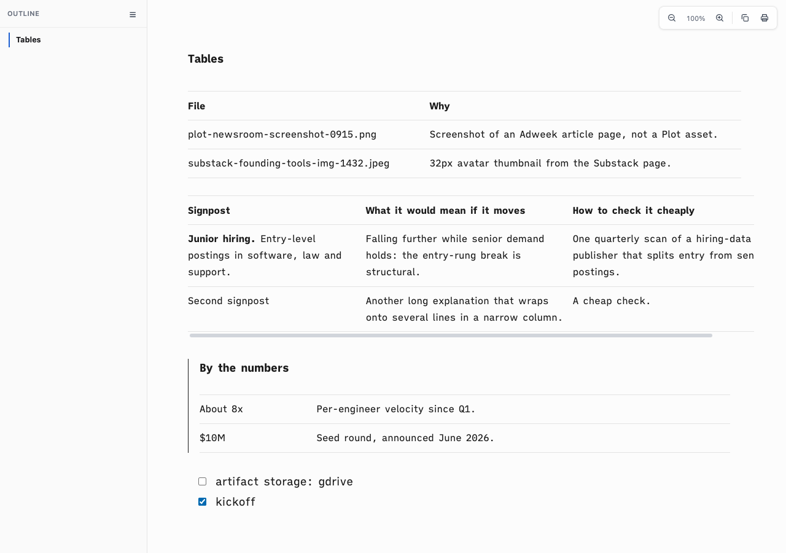

# Proof of Done, ia-table-soft-rules

The owner prefers soft grey table hairlines (his reference screenshot) over the ink rules of the iA template. Table rules now use `--ia-table-rule` (#e3e3e3 light, #3a3a3a dark, #bbb print); body cells keep the body weight and the rules stay on the cells.

## Green run

```
Command: bash tests/smoke.sh
Exit: 0
Output:
[ia-table] tables: soft hairlines between rows, body-weight cells, rules on the cells
smoke: all 68 passed
Verdict: PASS
```



## Rollback

Revert this squash commit to return to ink table rules.
