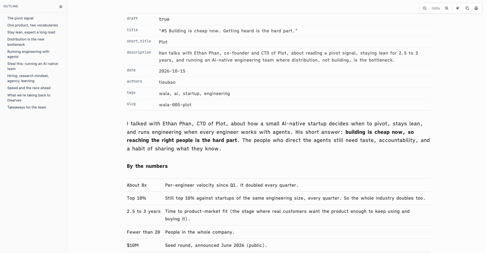

# Proof of Done, layout-check

One script now does the check that was hand-rolled each time: render a markdown file with `bin/spacedown`, open it in a private headless Helium at several widths, measure the layout, screenshot each width. `scripts/layout-check [--mode ia|tm|paper] [--widths 390,768,1470,1728] [--shots <dir>] [--skim] [--dark] <file.md>`. It exits 1 when any width scrolls sideways, else 0. `BROWSER` overrides the binary; every browser launch gets a fresh `--user-data-dir`, so the running browser is never touched.

## Green run

| Command | Exit | Verdict |
|---|---|---|
| `bash tests/smoke.sh` | 0 | PASS |
| `scripts/layout-check brand/content/wala/005-plot/article.md` | 0 | PASS |
| `scripts/layout-check --skim brand/content/wala/005-plot/article.md` | 0 | PASS |
| `scripts/layout-check --skim --dark --widths 1470 brand/content/wala/005-plot/article.md` | 0 | PASS |
| `scripts/layout-check tests/fixture/fixture.md` | 1 | PASS (reports a real 4px overflow at 390, see below) |

```
[layout-check] usage and argument errors need no browser
  ok: --help exits 0; no file and unknown option exit 64
smoke: all 94 passed
```

WALA #5 article, ia mode, headless Helium:

```
W=390 viewport=392 scroll=392 overflow=no content=20-372 gapLeft=20 gapRight=20 edges=372
W=768 viewport=760 scroll=760 overflow=no content=52-708 gapLeft=52 gapRight=52 edges=708
W=1470 viewport=1462 scroll=1462 overflow=no content=318-1398 gapLeft=78 gapRight=64 edges=1398
W=1728 viewport=1720 scroll=1720 overflow=no content=447-1527 gapLeft=207 gapRight=193 edges=1527
  bright-words: 440 of 2245 (19.6%)   (--skim, same at every width)
```

Every width has one right edge. The viewport is the window minus 8px of frame, and headless Helium will not go below a 400px window, so `W=390` measures a 392px viewport; the line prints both.

The fixture (`tests/fixture/fixture.md`) at 390px reports `overflow=yes scroll=396 edges=372/396`: its numeric table is 376px wide against a 352px column, a real 4px sideways scroll the script surfaced, not a script fault. It is not changed here.

The bright-word share is 19.6% here against 11.3% in the skim-mode proof because the article has since gained a bold key phrase in each paragraph (307 words in bold now); the script counts words inside `.sd-key`, `strong`, `b`, headings, `th` and the first `td` of a row.



## Negative control

The fixture with a 3000px-wide element appended, run at 390 and 1470:

```
W=390 viewport=392 scroll=3020 overflow=yes content=20-396 gapLeft=20 gapRight=-4 edges=372/396
W=1470 viewport=1462 scroll=3318 overflow=yes content=318-1398 gapLeft=78 gapRight=64 edges=1398
exit=1
```

## Rollback

Revert this squash commit. The script is a standalone helper; nothing else calls it.
