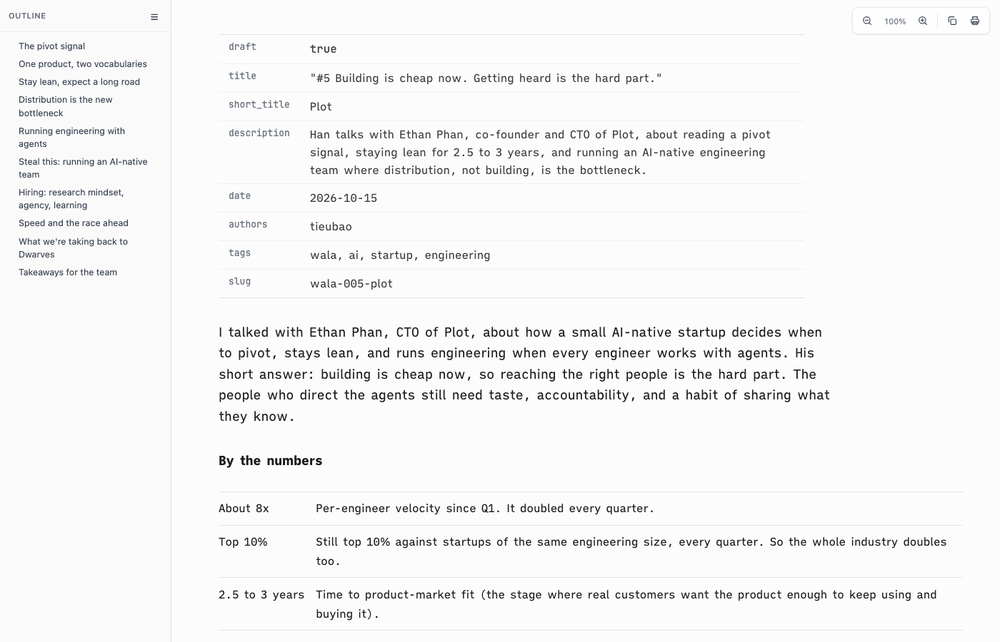
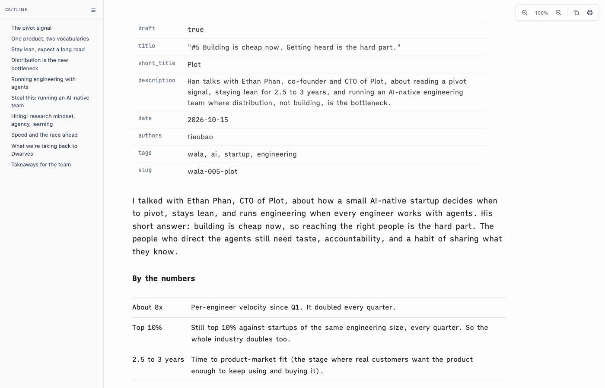

# Proof of Done, one-right-edge

Prose stops at the 48rem measure, but tables and section rules (`hr`) ran on to the 60rem page column. A page showed two right edges and an empty strip beside the prose. Tables that fit and rules now cap at the measure, and a capped rule starts on the text edge. A `.sd-wide` table still uses the page column and scrolls.

## Green run

| Command | Exit | Verdict |
|---|---|---|
| `bash tests/smoke.sh` | 0 | PASS |

```
[one-edge] tables that fit and section rules end on the prose measure
  ok: one right edge
smoke: all 73 passed
```

Right edges in headless Helium at a 1400px window, on the WALA #5 article:

| | prose | body tables | rule |
|---|---|---|---|
| before | 1170 | 1126 / 1325 | 1325 |
| after | 1170 | 1126 / 1170 | 1170 |

The 1126 table is the frontmatter table, which sizes to its content.

| before | after |
|---|---|
|  |  |

## Negative control

The prior `assets/vscode-preview-head.html` restored over the fix, same suite:

```
  FAIL: tables or rules run past the prose measure: the page has two right edges
smoke: 72 passed, 1 FAILED
```

## Rollback

Revert this squash commit.
