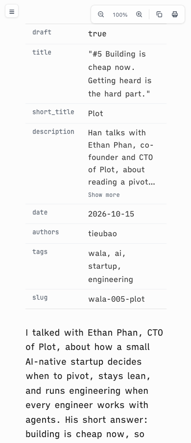
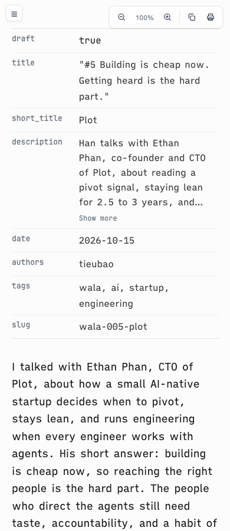
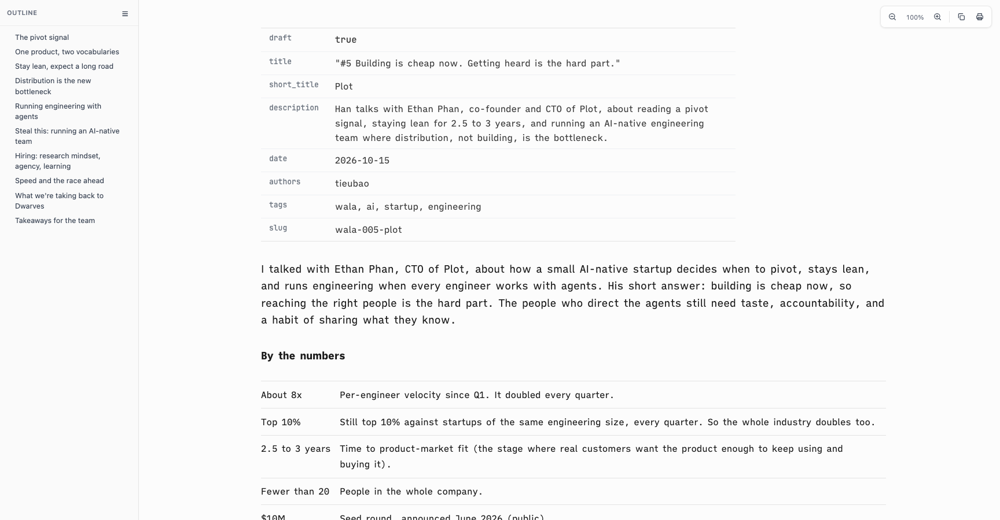
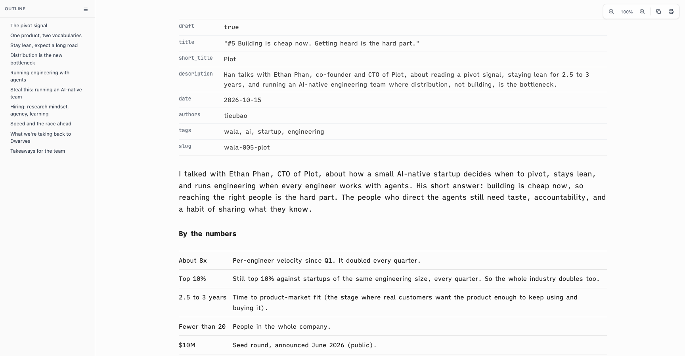

# Proof of Done, phone-gutters-fm-width

Two layout fixes. On phones, html and body each padded 26px, so text sat 52px in from each edge; phones (600px and below) now get one 20px gutter. The frontmatter table was capped at 820px (or sized to its content), so it ended short of the text; it now fills the column, and its keys start on the text edge.

## Green run

| Command | Exit | Verdict |
|---|---|---|
| `bash tests/smoke.sh` | 0 | PASS |

```
[phone-gutter] phones get one 20px gutter, not html plus body padding
  ok: phone gutter
[fm-width] the frontmatter table fills the column and its keys start on the text edge
  ok: frontmatter width
smoke: all 87 passed
```

Edges in headless Helium, WALA #5 article (frontmatter table, first key's text, first paragraph, numbers table; page scroll width over viewport width):

| window | before | after |
|---|---|---|
| 1728px | fm 440-1260, key 454, p 440-1520, table 440-1520, 1705/1705 | fm 440-1520, key 440, p 440-1520, table 440-1520, 1705/1705 |
| 390px | fm 52-325, key 66, p 52-325, table 52-325, 377/377 | fm 20-357, key 20, p 20-357, table 20-357, 377/377 |

No horizontal page scroll at either width. At 768px the page keeps its 26px gutters.

| before (390px) | after (390px) |
|---|---|
|  |  |

| before (1728px) | after (1728px) |
|---|---|
|  |  |

## Negative control

The prior `assets/reading-chrome-head.html` and `assets/vscode-preview-head.html` restored over the fix, same suite:

```
  FAIL: phone gutter missing: text sits 52px in from each edge on a phone
  FAIL: frontmatter table narrower than the column, or keys inset from the text edge
smoke: 85 passed, 2 FAILED
```

## Rollback

Revert this squash commit.
