# Proof of Done, r1-live-checks

Live checks of release 1 in the real Quick Look panel and the real app, on a macOS test VM (macOS 27.2.1, screen 1280x720 points at 2x). Every launch, click and keystroke happened inside the VM. No code changed: this PR adds this record and its screenshots only. Where a check failed, the cause is marked as a hypothesis and no fix was made.

## Verdicts

| # | Check | Verdict |
|---|---|---|
| 1 | Does the data-based Quick Look panel run JavaScript? | Answered on macOS 27.2.1. The result touches the extension's security model, so it went to the maintainers through the private route in CONTRIBUTING.md ("Report a vulnerability"), not into this public record |
| 2 | X-ray CSS checkbox toggle in the live panel | Pass |
| 3 | Box-drawing lines join in the live panel | Pass |
| 4a | Onboarding A1 buttons and states, Developer ID build | Pass, with one layout bug (window taller than a 720-point screen). The first-run window was shown with the `-onboarding.seen NO` override (see "State of the VM") |
| 4b | Safari row On/Off | Off: Pass. On: not verified (extension not listed in Safari) |
| 4c | App Group: a Settings write reaches the extension | Pass |

## Build under test

```
Command: SIGN_ID="Developer ID Application: <team> (W777S7V8TN)" NO_INSTALL=1 bash integrations/build-safari.sh --with-safari
Exit: 0
Output: build-safari: signing (Developer ID Application: ... + runtime + entitlements)...
        .../Build/Products/Release/Spacedown.app
Verdict: PASS (main at d918845, Developer ID signed, not notarized, nothing installed on the build Mac)
```

The app was copied into the VM's `/Applications` (an older test install was moved aside first, not deleted), then `qlmanage -r; qlmanage -r cache`. Proof that the panel ran this build and not an older one:

```
Command: codesign -dvvv <app>/Contents/PlugIns/SpacedownQL.appex | grep CDHash   (build Mac, then in the VM)
Exit: 0
Output: CDHash=c964214ad76c103680c885f0e2796d2dd2b00a3d   (same on both)
Command: pluginkit -mAvvv -i dfoundation.spacedown.quicklook   (VM)
Exit: 0
Output: +    dfoundation.spacedown.quicklook(1.1.0)
                    Path = /Applications/Spacedown.app/Contents/PlugIns/SpacedownQL.appex
Verdict: PASS, the registered extension is this build
```

Entitlements of the built appex (`codesign -d --entitlements -`): `com.apple.security.app-sandbox`, `com.apple.security.application-groups = [W777S7V8TN.dfoundation.spacedown]`, user-selected read-only, home-relative read-only.

## How the panel was driven

The VM's capture helper copies one file into the VM, runs `qlmanage -p <file>` in the desktop session, waits 14 s, sends a focus click, then the listed clicks, then captures the VM screen. Points are VM framebuffer pixels on the 2560x1440 framebuffer; the X-ray label sat at 1893,247. Screenshots are crops of the panel or window, halved.

## 2. X-ray toggle in the live panel

Fixture `xray-live.md` (not committed):

```
# X-ray live check

This sentence has an em dash &mdash; and it is really just a filler test, see SPEC-089 and TASK-019.

This is a deliberately long sentence that keeps going and going with many plain words so that it passes the twenty five word limit that the X-ray long sentence rule uses by default today.

Short line.
```

```
Command: qlmanage -p xray-live.md, capture; then the same with one click on the X-ray label (1893,247), capture
Exit: 0 (both captures saved)
Output: before: plain text, the X-ray label alone in the toolbar
        after: the dash, "really" and "just", SPEC-089 and TASK-019 filled; the 34-word sentence has a
               dotted underline and a 34w tag; the label shows the legend dash, long sentence, filler, ticket ID
Verdict: PASS
```

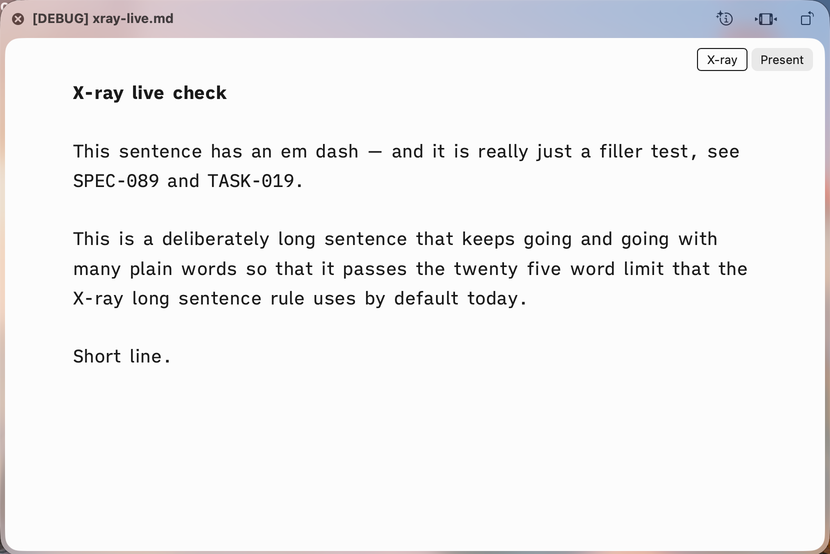
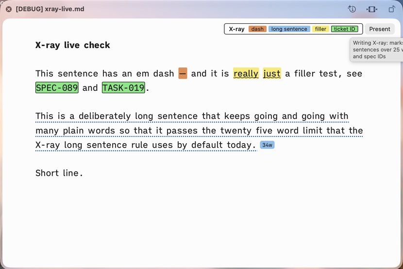

## 3. Box diagrams in the live panel

Fixture `box-live.md` (not committed): one fenced block with four boxes joined by `─────►`, `◄─────`, `┬`, `│` and `▼`, and one fenced file tree with `├──`, `│` and `└──`.

```
Command: qlmanage -p box-live.md, capture, then a full-resolution crop of the diagram
Exit: 0
Output: corners, tees and vertical bars join; box edges are continuous; the tree's verticals meet their branches
Verdict: PASS
```

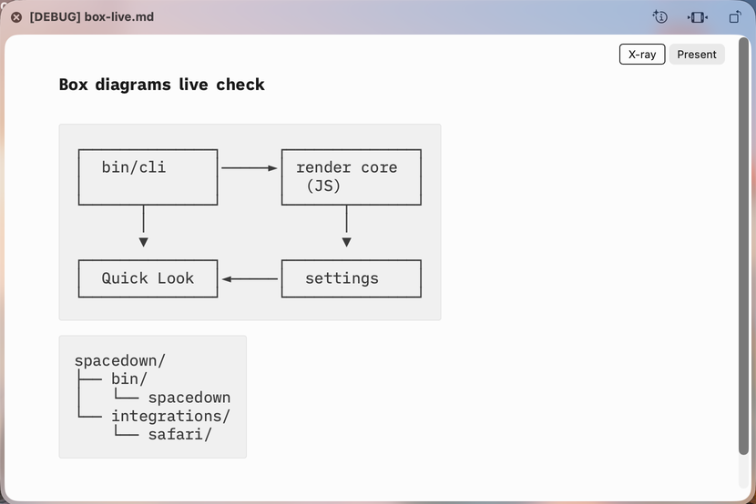
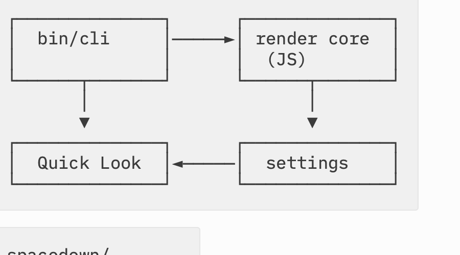

The half-cell gap between a box edge and an arrow shaft (`│─`) is how any monospace font lays out those two glyphs, not a fallback seam.

## 4. Onboarding A1 and A1b, Developer ID build, App Group

### State of the VM

The VM had run an older r1 test build. Its app container and group container could not be moved from a shell (`Operation not permitted`, macOS app data protection), so this is not a brand-new macOS user.

| Item | Before this run |
|---|---|
| `/Applications/Spacedown.app` | older build moved aside, this build copied in |
| Group prefs `~/Library/Group Containers/W777S7V8TN.dfoundation.spacedown/Library/Preferences/W777S7V8TN.dfoundation.spacedown.plist` | absent (`ls`: `No such file or directory`) |
| App container `dfoundation.spacedown` | present from the older build, unreadable from a shell |

On the first launch of this build no welcome window opened, only the main window; Help, "Welcome to Spacedown" was present. Hypothesis: the older build had already stored `onboarding.seen` in the kept app container. The first-run path was then run with the argument-domain override:

```
Command: open -n /Applications/Spacedown.app --args -onboarding.seen NO   (VM desktop session)
Exit: 0
Output: the "Welcome to Spacedown" window opened on its own, in front of the main window
Verdict: PASS (first-run code path); a launch with a truly empty container was not possible here
```

### Click-through

| Step | Result | Screenshot |
|---|---|---|
| First-run window | checklist, row 1 "Check with the sample", Safari row "Off in Safari", CLI row | `onboarding-start-safari-off.png` |
| Preview a sample | the system Quick Look panel opened on `Sample.md`, rendered by Spacedown (toolbar, table, typeset math) | `onboarding-preview-panel.png` |
| After the panel | "Try it now" with the two answer buttons | `onboarding-tryit.png` |
| It shows plain text instead | warning mark, "Quick Look still off", Fix it | `onboarding-off.png` |
| Fix it, then Copy | the button reads "Copied"; `pbpaste` in the VM printed `qlmanage -r && qlmanage -r cache` | `onboarding-fix-copied.png` |
| Open System Settings | opened straight to the Quick Look extensions sheet, Spacedown switched on | `onboarding-open-system-settings.png` |
| Preview the sample again, then Yes, it is rendered | "All set. The sample rendered." with a green mark | `onboarding-allset.png` |
| Open Safari Settings | Safari opened its Extensions pane; Spacedown was not listed | `safari-extensions-not-listed.png` |
| Done | the window closed | |

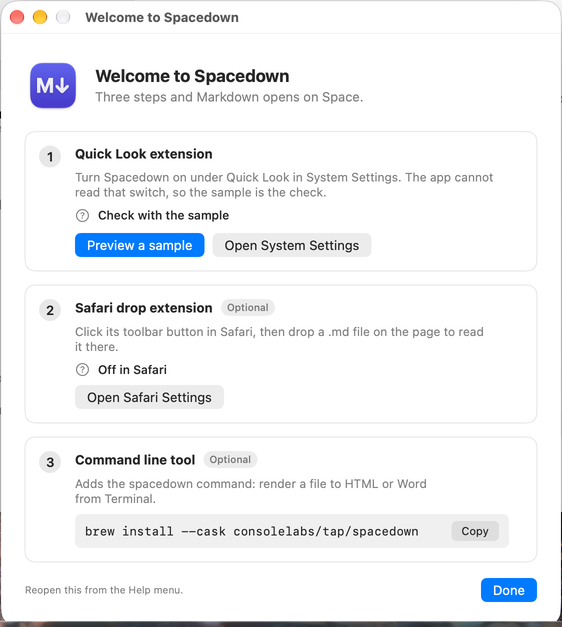
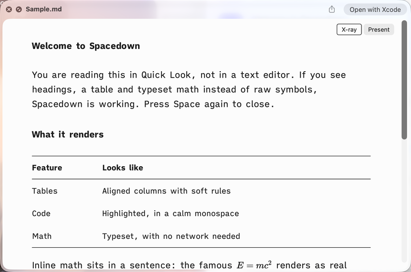
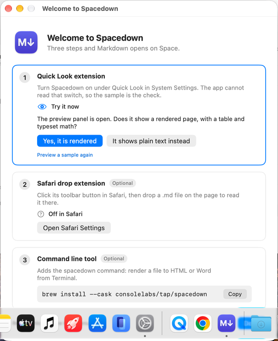
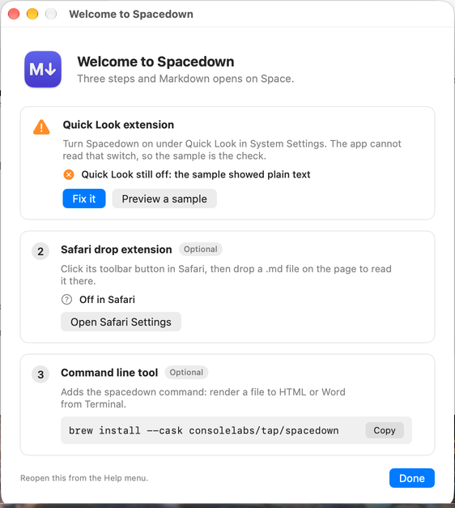
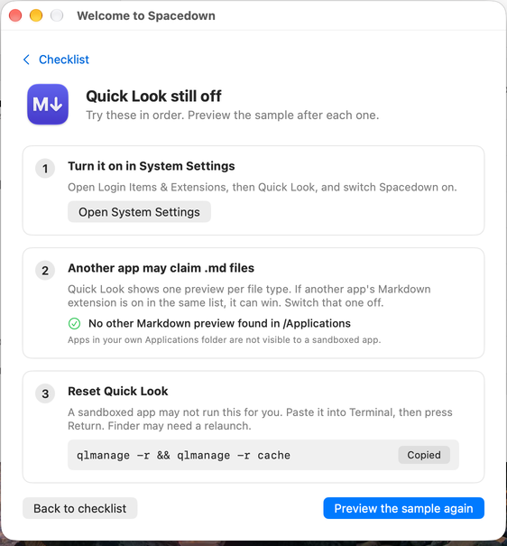
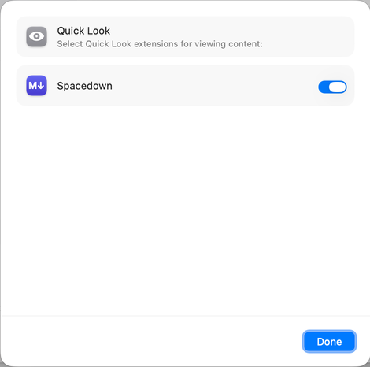
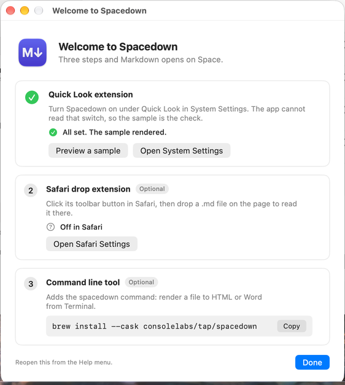


**Bug: the window is taller than the screen.** On this 1280x720-point screen the welcome window opened at y=177 with height 625 (window list readback), so its bottom 82 points were off screen and Done was hidden. It grows further in the "Try it now" state, and its bottom sits under the Dock. Moving the window up showed everything. Hypothesis: the window is placed with `center()` before SwiftUI sets its final height, and nothing caps the height to the visible frame or scrolls the content. A 720-point-tall screen is small for a Mac but occurs (VMs, some scaled external displays).

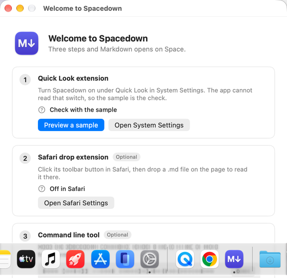

### Safari row

| State | Result |
|---|---|
| Off | PASS: the row reads "Off in Safari" with "Open Safari Settings" (`SFSafariExtensionManager` answered, `isEnabled` false) |
| On | Not verified: Safari's Extensions pane did not list the extension, so it could not be turned on |

Hypothesis: Safari hides a Developer ID extension that is not notarized, as the header of `integrations/build-safari.sh` says; the test build was not notarized (that needs a maintainer). Turning on Safari's "Allow unsigned extensions" asks for the account password; the dialog accepted the typed text but ignored OK and Return sent over the VM's screen connection, so that path was not completed.

### App Group

```
Command: ls <group prefs plist>   (VM, before any Settings change)
Exit: 1
Output: No such file or directory
Command: Spacedown, Settings, General, Text size stepper up to 24 px; then ls <group prefs plist>
Exit: 0
Output: -rw-------  ... 57 ... W777S7V8TN.dfoundation.spacedown.plist
Command: qlmanage -p xray-live.md   (same fixture as check 2)
Exit: 0
Output: the page renders at 24 px (18 px in xray-panel-off.png before the change)
Command: quit and relaunch the app, open Settings
Output: Text size still 24 px; Restore defaults puts it back to 18 px
Verdict: PASS, the app's write lands in the App Group and the sandboxed extension reads it on the next preview
```

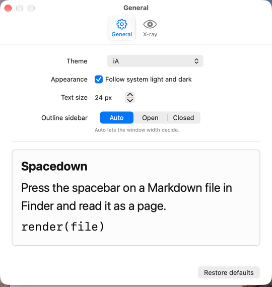
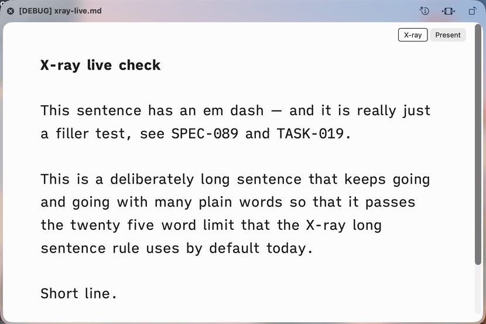

## Negative control

Docs only: no behavior changed, so there is no mutation to run. Each live check carries its own before state: X-ray off before the click, no group plist and an 18 px page before the Settings write, "Off in Safari" with the extension absent from Safari's list.

## Reproduce

1. On a Mac with the team's Developer ID identity: `SIGN_ID=<Developer ID Application identity> NO_INSTALL=1 bash integrations/build-safari.sh --with-safari`.
2. Copy the printed app into a test Mac or VM's `/Applications`, launch it once, run `qlmanage -r; qlmanage -r cache`.
3. `qlmanage -p` the two fixtures above; press X-ray on the first.
4. Onboarding: launch the app (or `open -n Spacedown.app --args -onboarding.seen NO`) and click through the rows; change Text size in Settings and preview again.

## Not verified

- The Safari row "On" state (above).
- A brand-new macOS user or a reset VM.
