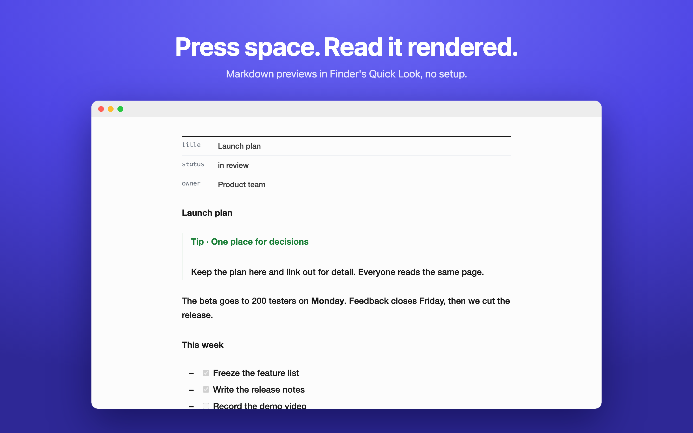
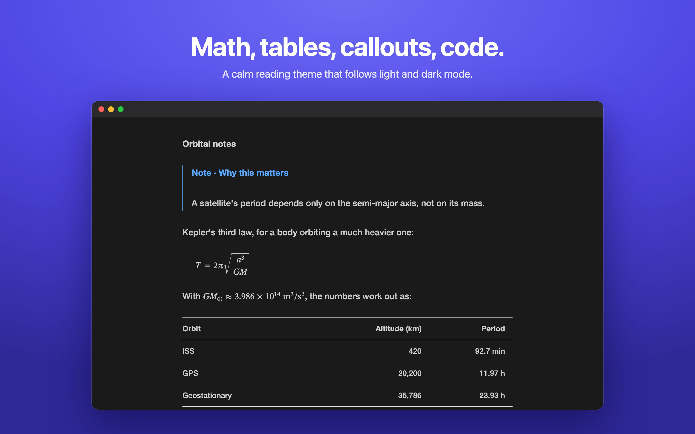
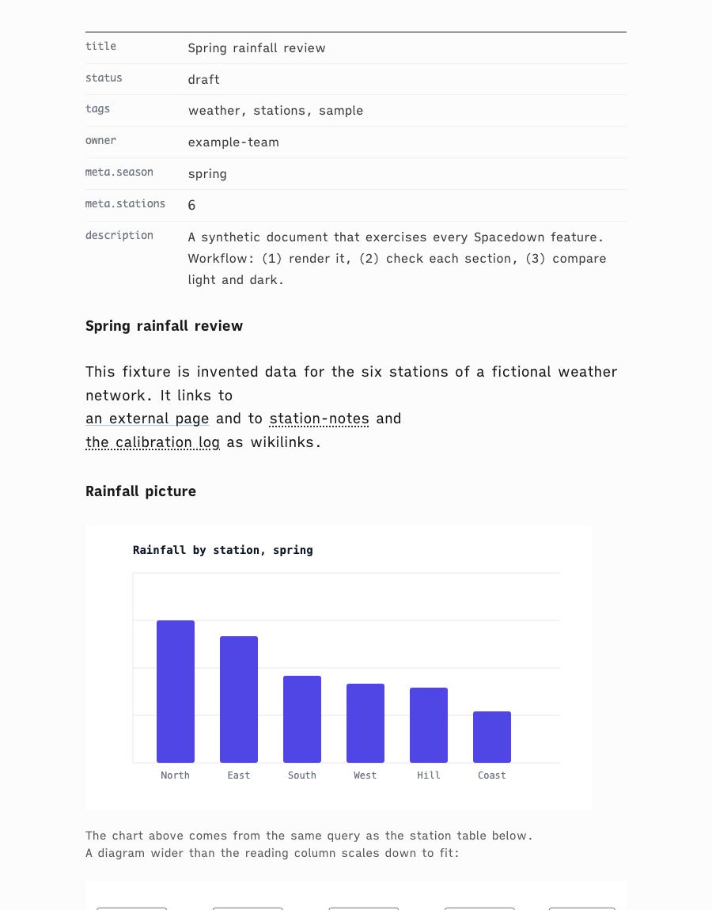
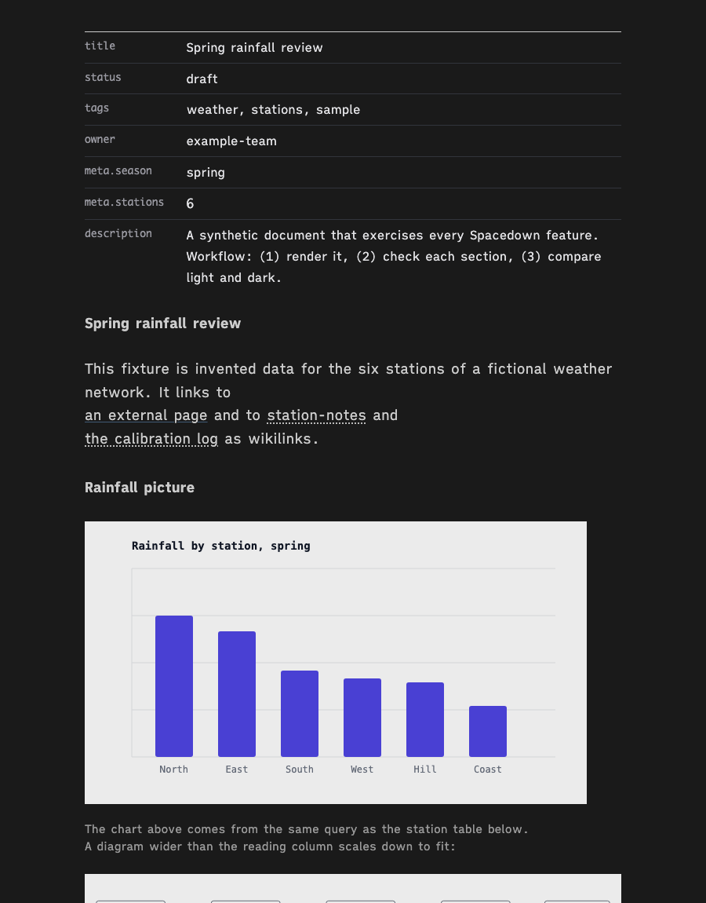

# Proof of Done, r1-screenshots

The App Store screenshots 1 and 2 and the README light and dark previews are re-rendered from the release 1 Quick Look pipeline. The three screenshot scripts take a `BROWSER` override (default unchanged: Brave), so a run can use a throwaway headless profile and never reach a running browser.

## Green run

| Command | Exit | Verdict |
|---|---|---|
| `BROWSER=<headless wrapper> bash scripts/window-shots.sh` | 0 | PASS (ql-light, ql-dark, safari-light) |
| `BROWSER=<headless wrapper> bash scripts/readme-shots.sh` | 0 | PASS (quicklook-light, quicklook-dark; app-window byte-identical, the app window page did not change) |
| `OUT=scripts/out BROWSER=<headless wrapper> bash scripts/store-shots.sh` | 0 | `1-light.png: 2880 1800`, `2-dark.png: 2880 1800`, copied to `docs/app-store/screenshots/1-quicklook.png` and `2-dark.png` |
| `bash -n scripts/{window,readme,store}-shots.sh` | 0 | PASS |

Each PNG was opened and read: light and dark render in the iA Writer faces (README) or the system faces (store, by design), frontmatter table, callout, tasks, KaTeX and tables typeset. Screenshot 3 (app window) is unchanged on purpose: the script header keeps it as is.

## Negative control

With `BROWSER` unset the scripts fall back to the original Brave path, so the old behavior is the default; the override line is the only script change (`git diff scripts/`).

## Limits

The X-ray and Present toolbar is not in these renders: `render-file.js` plus `qlwrap.js` emit the body only. `docs/images/quicklook-panel.png` is a real panel capture and was not regenerated.

## Captured run

```
Command: syntax check of the three scripts, then pixel size of each regenerated PNG, then the staged diff
Exit: 0
Output:
syntax rc=0
docs/app-store/screenshots/1-quicklook.png 2880 1800 
docs/app-store/screenshots/2-dark.png 2880 1800 
docs/images/quicklook-light.png 900 1150 
docs/images/quicklook-dark.png 900 1150 
Verdict: PASS
```

## After

| Store 1 | Store 2 |
|---|---|
|  |  |

| README light | README dark |
|---|---|
|  |  |
