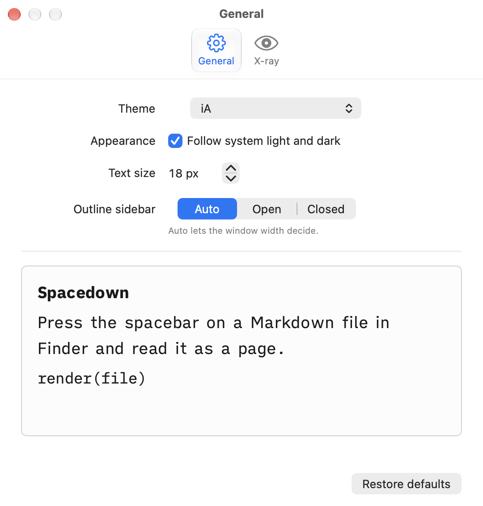
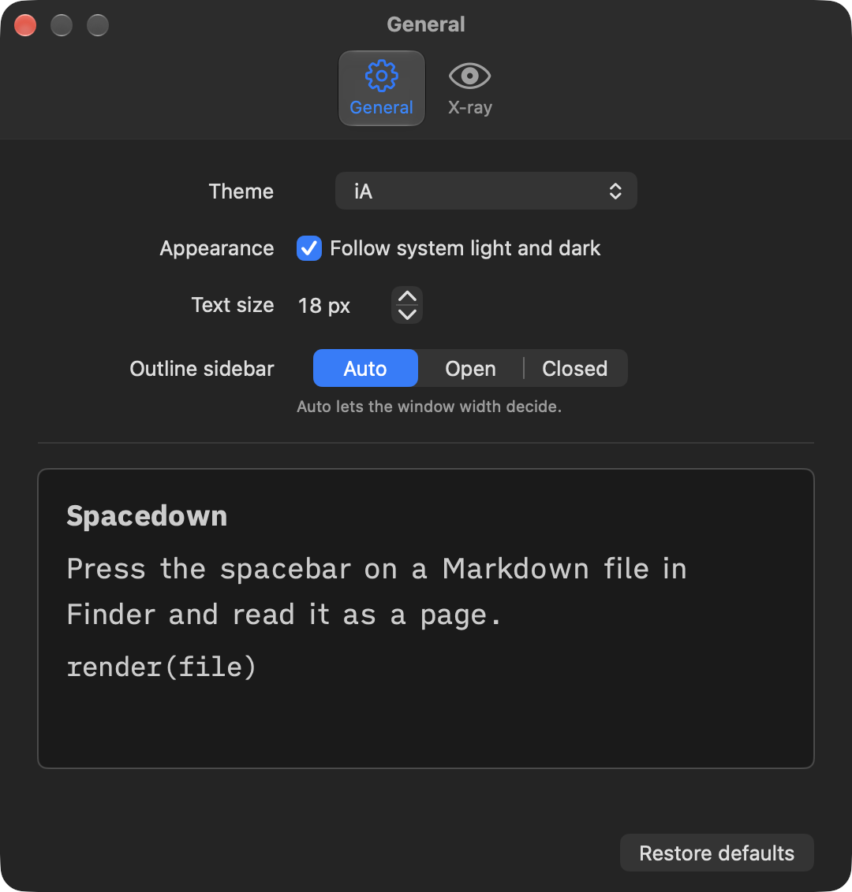
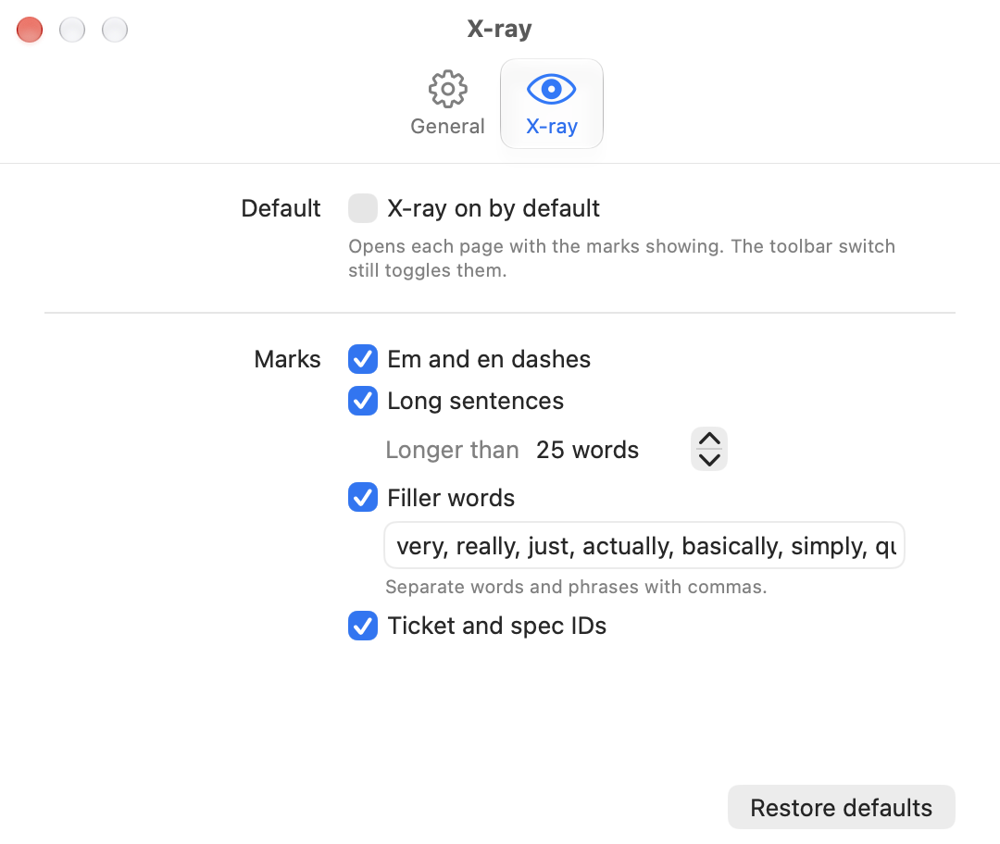
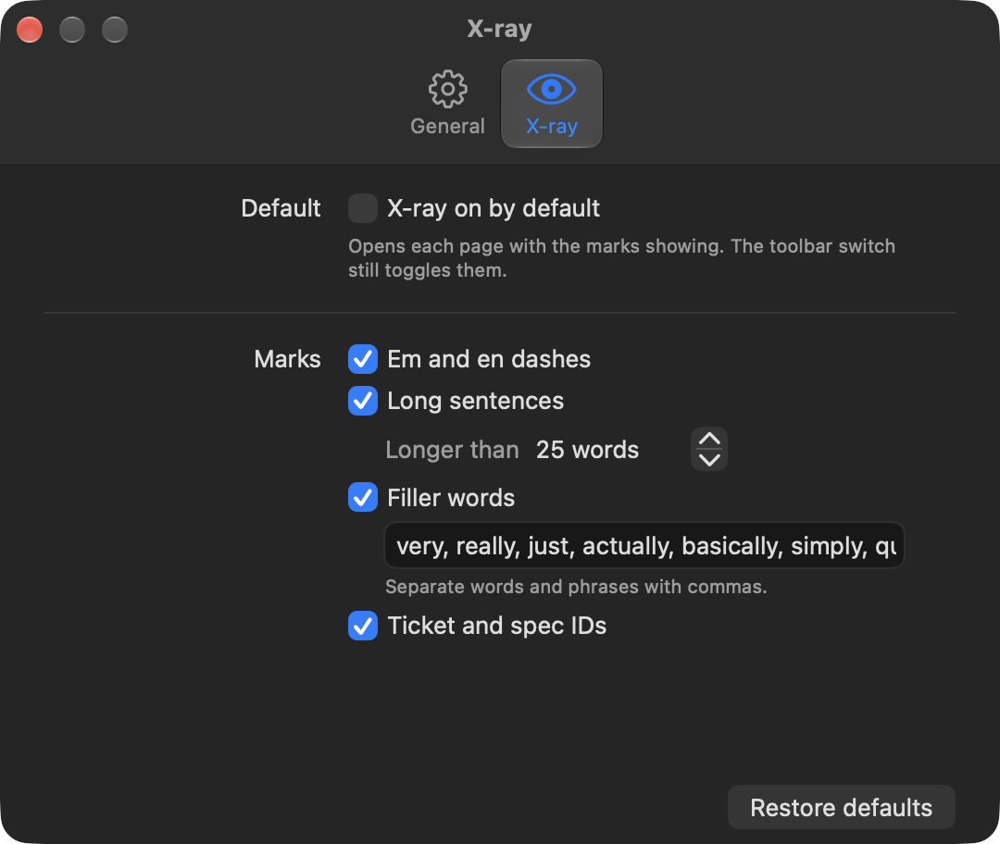
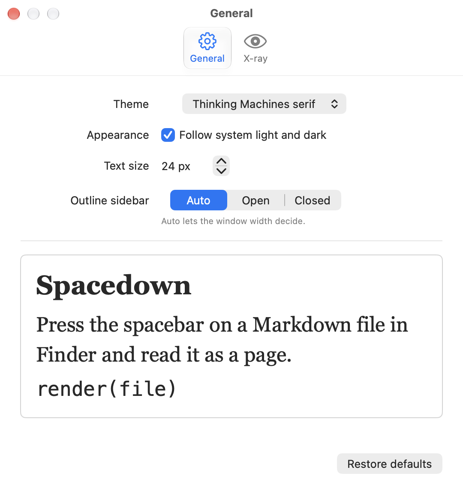

# Proof of Done, r1-settings

The app has a native Settings window (menu item "Settings..." with Cmd+,): a toolbar of two tabs, General and X-ray. General holds the theme picker, "Follow system light and dark" (plus an explicit Light or Dark choice), the text size stepper (12 to 32), the outline sidebar default (Auto, Open, Closed) and a live type preview. X-ray holds "X-ray on by default", one switch per rule, the sentence word limit (8 to 80) and the filler word list (comma separated). Every control reads and writes `SpacedownSettings.store` under the contract's key names and types. "Restore defaults" on a tab removes that tab's keys, so every reader falls back to the render core's own defaults. `ql-settings.css` turns `data-sd-theme`, `data-sd-appearance`, `data-sd-outline` and `--ql-size` into the reading look.

| Case | Behaviour | Where it lives |
|---|---|---|
| Theme | `ia`, `tm`, `paper`, `read`, `mono`; the preview uses the theme's face, ground and ink | `ThemeOption`, `ql-settings.css` theme blocks |
| Appearance | A switch writes `system`; off shows Light or Dark and writes `light` or `dark`; the preview follows | `GeneralSettingsView` |
| Forced appearance in the page | `light` or `dark` repeats the token flips of md-style, ql-reading and the highlight theme | `ql-settings.css` appearance blocks |
| Text size | Stepper clamped 12 to 32; the page gets it from `--ql-size` (already wired in `ql-reading.css`) | `SettingsModel.textSize` |
| Outline default | `auto`, `open`, `closed`; the Quick Look page has no outline, so the CSS only sets the first paint of the browser outline | `ql-settings.css` last block |
| X-ray rules | Four switches, a word limit, a filler list, "on by default" | `XraySettingsView` |
| Filler list | Trimmed, empty entries dropped, stored as `[String]`; an untouched list is never stored | `SettingsModel.saveFillers` |
| Missing or invalid stored value | Reads as the default; out of range ints clamp | `SettingsModel.Snapshot` |
| Restore defaults | Per tab: removes that tab's keys and reloads | `SettingsModel.restoreDefaults` |
| Release 2 | Inbox and License tabs are not shown; `SettingsTab.shown` is the one place to add them | `SettingsTab` |
| Screenshot hook | `SPACEDOWN_SETTINGS_TAB=general\|xray` opens Settings at launch; `SPACEDOWN_SETTINGS_APPEARANCE=light\|dark` sets the window's own appearance. Never writes the store | `SettingsWindow.install` |

## Green run

Command: `NO_INSTALL=1 bash integrations/build-safari.sh`
Exit: 0
Output:

```
build-safari: embedded the iA Writer fonts into the reading skin
build-safari: bundled the spacedown CLI into Contents/Resources/cli
build-safari: signing (- + runtime + entitlements)...
integrations/safari/SpacedownDrop/build/Build/Products/Release/Spacedown.app/Contents/PlugIns/SpacedownQL.appex: replacing existing signature
integrations/safari/SpacedownDrop/build/Build/Products/Release/Spacedown.app: replacing existing signature
integrations/safari/SpacedownDrop/build/Build/Products/Release/Spacedown.app
```

Verdict: PASS (app and Quick Look appex build and sign (last lines))

Command: `bash tests/smoke.sh --only quicklook,bundle`
Exit: 0
Output:

```
[39] Quick Look render core
  ok: ql-render suite passes
[39b] release-1 contract
  ok: contract suite passes
[39c] render core under osascript
  ok: osascript renders with every plug-in
[39d] sd-settings
  ok: stored settings as JSON, {} when missing
[39e] box-drawing plug-in
  ok: boxdraw suite passes
[bundle-1] bundle-cli lays out the CLI and every runtime file under Contents/Resources/cli
  ok: layout complete, scripts executable, maintainer notes left out
[bundle-2] bundle-cli refuses a path that is not an app bundle
  ok: exit 64
[bundle-3] the bundled CLI, moved and run through a symlink, renders the same HTML as the repo CLI
  ok: byte-identical page (theme, chrome, frontmatter table, callout)
[bundle-4] the bundled CLI embeds the iA fonts
  ok: font faces embedded from the bundle
[bundle-5] the bundled CLI exports .docx in the iA look
  ok: docx from the bundle
[bundle-6] build-safari.sh bundles the CLI by default; the store build opts out
  ok: default on, MAS build off

smoke: all 11 passed
```

Verdict: PASS (every section check passes)

Command: `bash docs/verification/r1-settings/check-model.sh`
Exit: 0
Output:

```
ok   an empty store reads as the contract defaults
ok   X-ray defaults
ok   the text field writing back an untouched list stores nothing
ok   theme saved as string
ok   appearance saved as string
ok   textSize saved as int
ok   outlineDefault saved as string
ok   xrayEnabled saved as bool
ok   xrayDashes saved as bool
ok   xrayLongSentences saved as bool
ok   xraySentenceWords saved as int
ok   xrayFillers saved as bool
ok   xrayFillerWords saved as trimmed list, empty entries dropped
ok   xrayTicketIds saved as bool
ok   a new window reads back what was saved
ok   out-of-range int clamps, unknown enum falls back to the default
ok   Restore defaults on General clears General keys
ok   Restore defaults on General leaves X-ray keys alone
ok   Restore defaults on X-ray clears the rest
check-model: all passed
```

Verdict: PASS (key names, types, clamping, per-tab restore)

Command: `bash docs/verification/r1-settings/check-css.sh`
Exit: 0
Output:

```
ok   ia appearance=system mac=light size=18: rgb(252, 252, 252) 18px
ok   ia appearance=system mac=dark size=18: rgb(26, 26, 26) 18px
ok   tm appearance=system mac=light size=22: rgb(255, 255, 255) 22px
ok   paper appearance=system mac=light size=18: rgb(251, 250, 247) 18px
ok   paper appearance=system mac=dark size=18: rgb(31, 30, 28) 18px
ok   read appearance=system mac=light size=20: rgb(252, 252, 252) 20px
ok   mono appearance=system mac=light size=18: rgb(252, 252, 252) 18px
ok   tm appearance=dark mac=light size=32: rgb(27, 26, 25) 32px
ok   paper appearance=light mac=dark size=12: rgb(251, 250, 247) 12px
check-css: all 9 cases passed
```

Verdict: PASS (computed ground, face and size per theme, appearance and Mac scheme)

Command: `bash docs/verification/r1-settings/check-e2e.sh`
Exit: 0
Output:

```
stored: {"textSize":24,"theme":"tm"}
ok   page has style="--ql-size:24px"
ok   page has data-sd-theme="tm"
ok   page has <h1
check-e2e: passed
```

Verdict: PASS (a saved setting shows in the page the appex builds)

## Screenshots

Window captures with `screencapture -l` from the built app (adhoc build, launched with the screenshot hooks, then quit).

| Tab | Light | Dark |
|---|---|---|
| General | `r1-settings/general-light.png` | `r1-settings/general-dark.png` |
| X-ray | `r1-settings/xray-light.png` | `r1-settings/xray-dark.png` |







`r1-settings/e2e-general-signed.png` is the Developer ID build reading a group container plist that holds `textSize` 24 and `theme` tm: the window shows 24 px and Thinking Machines serif.

## What the end-to-end check does and does not cover

| Link | Result |
|---|---|
| Window controls write the store | Covered by `check-model.sh` (model driven in code, no pointer or key input to the owner's Mac) |
| Developer ID build is granted the App Group and reads the group container plist | Covered: screenshot above |
| Stored settings change the page the appex builds | Covered by `check-e2e.sh`, through the appex's own `buildPreviewHTML` compiled into a throwaway tool, fed by `scripts/sd-settings` from a scratch plist |
| The sandboxed appex running in a live Quick Look panel | Not run: no Quick Look host loads a NO_INSTALL build |
| `defaults write W777S7V8TN.dfoundation.spacedown ...` from a terminal | Does NOT reach the app: a signed sandboxed app maps that suite to `~/Library/Group Containers/W777S7V8TN.dfoundation.spacedown/Library/Preferences/`, while the CLI tool writes `~/Library/Preferences/`. The app still showed 18 px after `textSize` 24 was written that way. Write the plist by path to test. |

## Negative control

| Change | Expected | Result |
|---|---|---|
| `CSS=/dev/null bash docs/verification/r1-settings/check-css.sh` (no settings CSS) | theme and forced-appearance cases fail | FAIL: 7 of 9 cases red (tm, paper, read, mono, and both forced-appearance cases); the two `ia` cases stay green because the default skin needs no settings CSS |
| Save `textsize` instead of `textSize` in `SettingsModel` | `check-model.sh` fails on the key names | FAIL: "textSize saved as int" and "a new window reads back what was saved" (2 of 19), then the change was reverted |

## Found on the way

| Finding | Detail |
|---|---|
| Sandbox start hang | Between about 00:16 and 00:21 the built app hung at launch in `_libsecinit_appsandbox` (waiting on an XPC reply), for adhoc and for Developer ID builds, launched directly and through `open`. Minutes later the same adhoc build, and scratch copies with the real entitlements, ran normally. Not reproduced after that; looks like a transient system stall while several nodes built and launched sandboxed apps. |
| SwiftUI text field | A `TextField` writes its binding back when it loses focus, even unchanged, which stored a copy of the default filler list on open. Fixed in `saveFillers`; `check-model.sh` covers it. |
