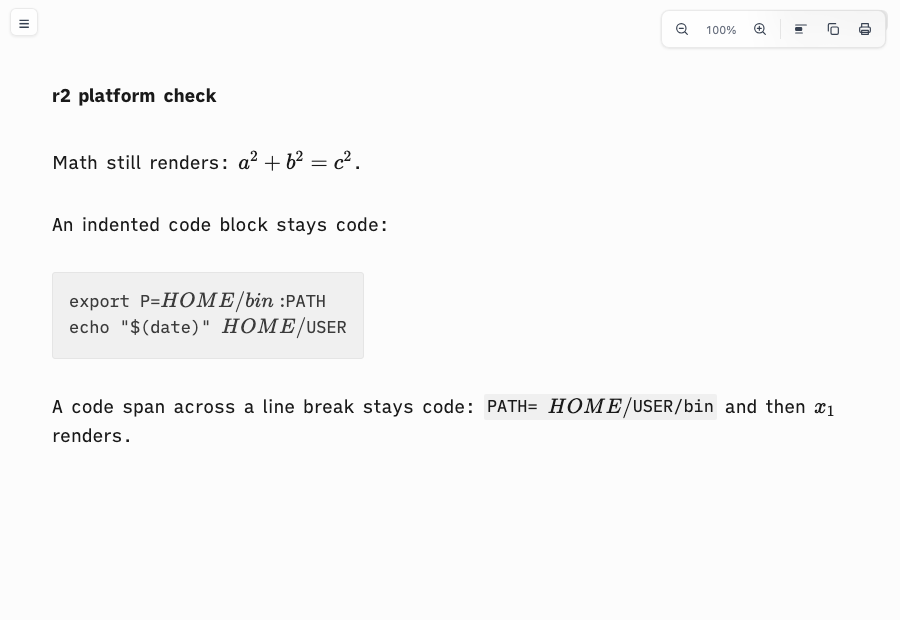
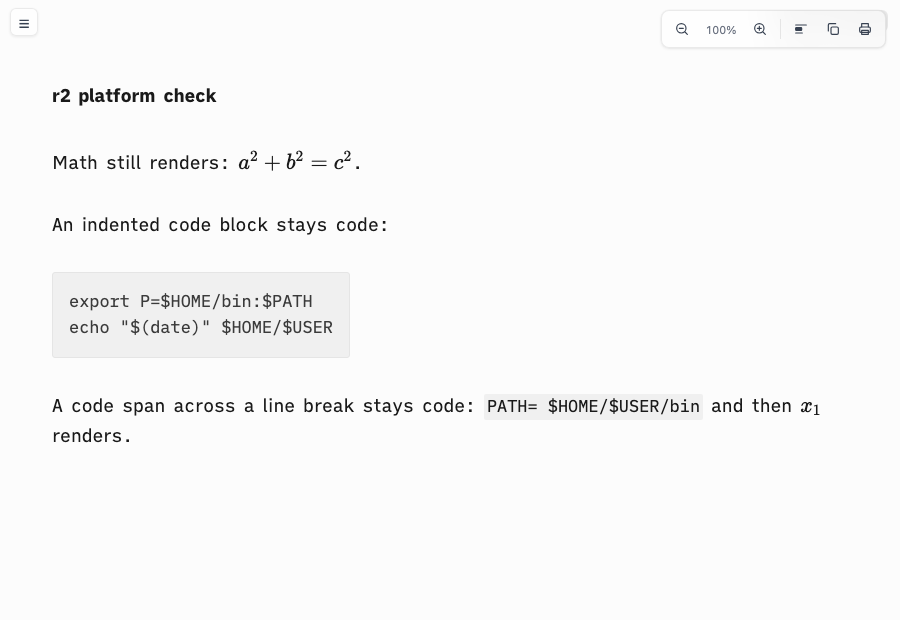
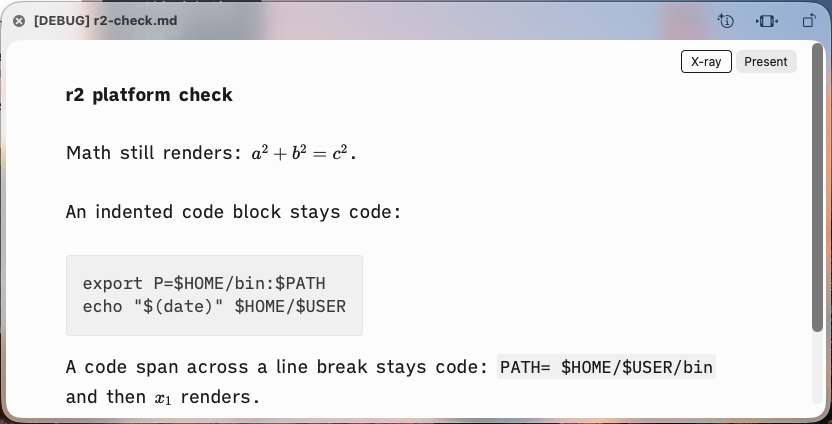
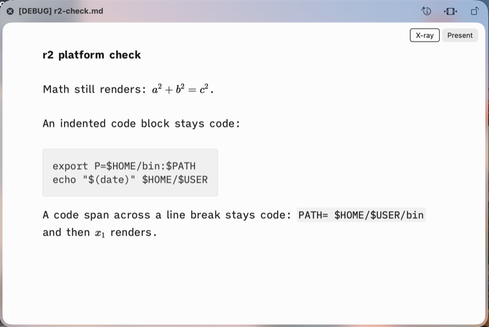

# Proof of Done, r2-platform

Contract change for release 2. macOS 13 is the floor in every target, every build is universal (arm64 and x86_64), a Debug build (`CONFIG=Debug`) carries `.dev` ids so it installs beside a release, the unused `Icon.png` stub is gone, and the render core shields indented code blocks and code spans that cross a line break. The version in the two frozen project files moves to 1.2.0 here, because the agent guard keeps frozen files on `contract/` branches; `bin/spacedown`, the manifests and the CHANGELOG follow in the release-prep PR.

## Verdicts

| # | Check | Verdict |
|---|---|---|
| 1 | Release ids unchanged; Debug ids, App Group and helper service carry `.dev` | PASS |
| 2 | Both slices in the app and the extension, `minos 13.0` and `LSMinimumSystemVersion 13.0` in both | PASS |
| 3 | Size budget passes the universal release build with the new numbers | PASS |
| 4 | Code shield: indented blocks and multi-line spans stay literal; list and lazy lines keep their math | PASS |
| 5 | Smoke and unit tests under `/bin/bash` | PASS |
| 6 | A Debug build and a Release build installed together on a test VM, each previewed in the live panel | PASS |

## 1 and 2. Ids, floor and architectures

```
Command: NO_INSTALL=1 bash integrations/build-safari.sh, then CONFIG=Debug NO_INSTALL=1 bash integrations/build-safari.sh
         (both also with SIGN_ID=<Developer ID>), then for each app and appex: Info.plist keys, lipo -archs,
         vtool -show-build, codesign -d --entitlements -
Exit: 0
Output:
  Release  Spacedown.app        dfoundation.spacedown             "Spacedown"                 x86_64 arm64  minos 13.0  LSMinimumSystemVersion 13.0
           SpacedownQL.appex    dfoundation.spacedown.quicklook   "Spacedown Quick Look"      x86_64 arm64  minos 13.0  LSMinimumSystemVersion 13.0
           App Group            W777S7V8TN.dfoundation.spacedown (app and appex)
  Debug    Spacedown.app        dfoundation.spacedown.dev         "Spacedown Dev"             x86_64 arm64  minos 13.0  LSMinimumSystemVersion 13.0
           SpacedownQL.appex    dfoundation.spacedown.dev.quicklook "Spacedown Dev Quick Look" x86_64 arm64 minos 13.0  LSMinimumSystemVersion 13.0
           App Group            W777S7V8TN.dfoundation.spacedown.dev (app and appex)
  Debug --with-safari: Safari appex dfoundation.spacedown.dev.Extension; its mach-lookup entitlement, the helper
           binary and the extension binary all name dfoundation.spacedown.render.dev; the rendered LaunchAgent has
           Label and MachServices dfoundation.spacedown.render.dev and runs spacedown-render-dev
Verdict: PASS
```

Before this change (main, same commands): the appex was `minos 12.0` and `LSMinimumSystemVersion 12.0`, both binaries `arm64` only. The Release ids and entitlements above are identical to main's, apart from the version.

## 3. Size

Measured as `scripts/release.sh` builds it: Developer ID signed, `SKIN_CSS=` blank, CLI bundled, DMG made with `hdiutil create -volname Spacedown -srcfolder <stage with app + /Applications> -fs HFS+ -format UDZO`, then signed. Not notarized.

| Number | Before (r1-size-final, arm64) | After (universal) |
|---|---|---|
| App | 2,208,095 | 2,712,573 |
| DMG | 1,233,954 | 1,419,168 |
| Budget | app 2,300,000, dmg 1,300,000 | app 2,800,000, dmg 1,500,000 (measured, rounded up to the next 0.1 MB) |

```
Command: bash scripts/size-budget <release app> <release dmg>
Exit: 0
Output:
  size-budget: app 2712573 bytes (budget 2800000)
  size-budget: dmg 1419168 bytes (budget 1500000)
  size-budget: ok
Verdict: PASS
```

`tests/size-budget-test.sh` moves its oversized fixtures above the new budget (2.9 MB app, 1.6 MB dmg); at 2.4 MB and 1.4 MB they would now pass and the test would prove nothing. `site/index.html` says 1.4 MB download.

## 4. Code shield

Rules (also in `docs/implementation-notes/r2-platform.md`): an indented block is four columns more than the enclosing list item's content (zero outside a list), after a blank line, a heading or the start of the document. A span that does not close on its own line pairs with the next open run of the same length on a later line of the same paragraph, and is stashed one line at a time, so the math pass (one line at a time) cannot pair a `$` before the span with one after it.

```
Command: node integrations/safari/quick-look/test-render.js
Exit: 0
Output (new checks):
  ok: indented block keeps $VAR and $(cmd) literal
  ok: tab-indented block at the start keeps $ literal
  ok: indented > [!note] stays code
  ok: indented block inside a blockquote keeps $ literal
  ok: indented block right under a heading keeps $ literal
  ok: indented lazy paragraph line still renders math
  ok: list continuation indented four spaces still renders math
  ok: nested list item renders math, its own indented code stays literal
  ok: code span across a line break keeps $ literal
  ok: code span across a line break in a blockquote keeps $ literal
  ok: a stray backtick does not reach past a blank line
  ok: a span never joins two list items
  ok: a span never crosses a heading line
ql-render: PASS
Verdict: PASS
```

Before and after on the same fixture as check 6, through the CLI, which renders with the same core (`spacedown <file> --offline --shot`; main's checkout, then this branch). Before, `$HOME/bin:$` and `$HOME/$` inside the block and the span are typeset as math:




A corpus check, old core against new on 13,888 Markdown files from local checkouts: 13,878 render byte for byte the same. The 10 that differ all lose KaTeX that sat inside code (13 formulas in all), and 3 of them also lose a leaked `SDCODEPLACEHOLDER` string. No file gains a formula. A first version that paired spans across lines strictly by position made three files gain formulas in prose; the per-line-first pairing above removed that.

## 5. Suites

| Command (all under `/bin/bash`) | Exit | Result |
|---|---|---|
| `bash tests/smoke.sh` | 0 | `smoke: all 192 passed` |
| `bash tests/katex-one-test.sh <universal release app>` | 0 | `katex-one-test: 11 passed, 0 failed` |
| `bash tests/size-budget-test.sh` | 0 | `size-budget-test: 5 passed, 0 failed` |
| `node tests/hljs-bundle-test.js` | 0 | `hljs-bundle-test: all passed` |
| node `test-render`, `test-contract`, `test-boxdraw`, `test-xray`, `test-present` | 0 | PASS each |

## 6. Debug and Release side by side in the live panel

On a macOS 27.2.1 test VM, every launch and keystroke inside the VM. Both apps were Developer ID signed (not notarized) and copied into `/Applications`; an older install was moved aside, not deleted.

```
Command: pluginkit -mAvvv -i <id> for both ids; lipo and the CDHash of each installed appex
Exit: 0
Output:
  +    dfoundation.spacedown.quicklook(1.2.0)      Path = /Applications/Spacedown.app/Contents/PlugIns/SpacedownQL.appex
  +    dfoundation.spacedown.dev.quicklook(1.2.0)  Path = /Applications/Spacedown Dev.app/Contents/PlugIns/SpacedownQL.appex
       Display Name = Spacedown Dev Quick Look
  /Applications/Spacedown.app: dfoundation.spacedown x86_64 arm64          CDHash=1c2f1d32d9c94130862590d9276a87d04f0497f7
  /Applications/Spacedown Dev.app: dfoundation.spacedown.dev x86_64 arm64  CDHash=586e3f1aecc8350597fc23d0232c457debce1b74
Verdict: PASS, both registered at once, each under its own id
```

Each preview ran with one extension elected (`pluginkit -e use` on one id, `-e ignore` on the other), and the unified log names the binary that rendered:

```
Command: qlmanage -p r2-check.md, capture; /usr/bin/log show --style ndjson --predicate 'process == "SpacedownQL"'
Exit: 0
Output:
  Dev elected:     processImagePath /Applications/Spacedown Dev.app/Contents/PlugIns/SpacedownQL.appex/Contents/MacOS/SpacedownQL
  Release elected: processImagePath /Applications/Spacedown.app/Contents/PlugIns/SpacedownQL.appex/Contents/MacOS/SpacedownQL
Verdict: PASS
```

The fixture (not committed) has inline math, a four-space block with `$HOME/bin:$PATH` and `$HOME/$USER`, and a code span that breaks after `PATH=`. Both panels show the math typeset and both kinds of code literal. `[DEBUG]` in the title is `qlmanage`'s own preview mode, shown for every build.




## Negative control

Each break was made after the change, run, and reverted with `git checkout`.

```
Command: the new test-render.js against main's ql-render.js
Exit: 1
Output:
  FAIL: indented block keeps $VAR and $(cmd) literal
  FAIL: tab-indented block at the start keeps $ literal
  FAIL: indented > [!note] stays code
  FAIL: indented block inside a blockquote keeps $ literal
  FAIL: indented block right under a heading keeps $ literal
  FAIL: nested list item renders math, its own indented code stays literal
  FAIL: code span across a line break keeps $ literal
  FAIL: code span across a line break in a blockquote keeps $ literal
ql-render: 8 FAILED
Verdict: RED as expected (the five list, lazy and stray-backtick guards pass on both cores)

Command: build-safari.sh with ARCH_SETTINGS emptied, NO_INSTALL=1, then lipo -archs on both binaries
Exit: 0 (build), lipo prints "arm64" twice
Verdict: RED as expected: without the setting the build is single-arch

Command: build-safari.sh with the Debug GROUP_ID left without .dev, then node test-contract.js
Exit: 1
Output: FAIL: the Debug App Group is the release group plus .dev, in Swift and in build-safari.sh
Verdict: RED as expected

Command: APP_BUDGET_BYTES=2300000 DMG_BUDGET_BYTES=1300000 bash scripts/size-budget <release app> <release dmg>
Exit: 1
Output:
  size-budget: FAIL app is 412573 bytes over budget; largest files: ...
  size-budget: FAIL dmg is 119168 bytes over budget
Verdict: RED as expected: the old budget refuses the universal build
```

## Not proven

- Nothing was run on an Intel Mac or under Rosetta; the x86_64 slices are shown by `lipo` and `vtool` only.
- The release build was not notarized; the 0.1 MB rounding is the room for the ticket.
- The Debug Safari extension and render helper were built and inspected, not loaded in Safari.
- The App Group split was checked in the signatures and the binaries, not by writing a setting in each app.

## Rollback

Revert the squash commit: back to a 12.0 extension floor, arm64-only builds, one set of ids for every configuration, the 2.3 MB and 1.3 MB budget, and the line-based shield.
