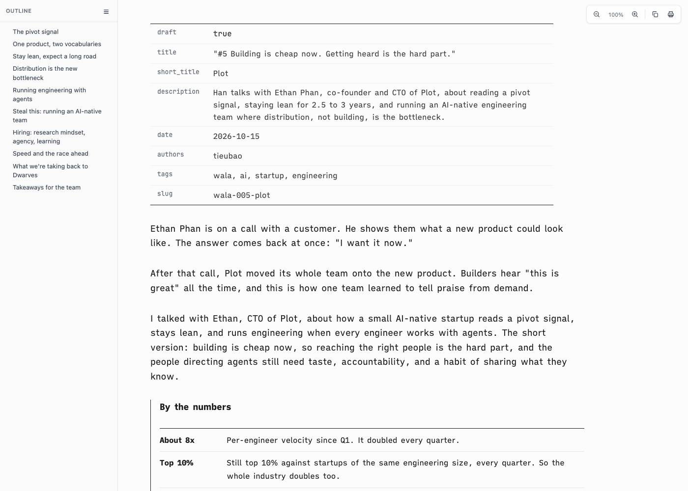
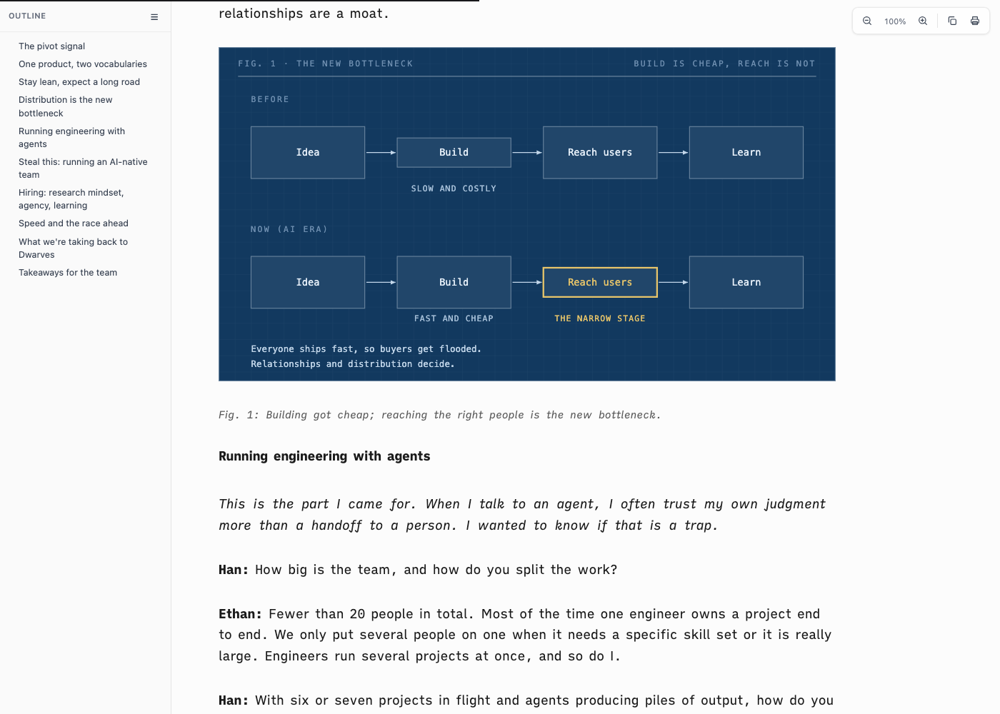
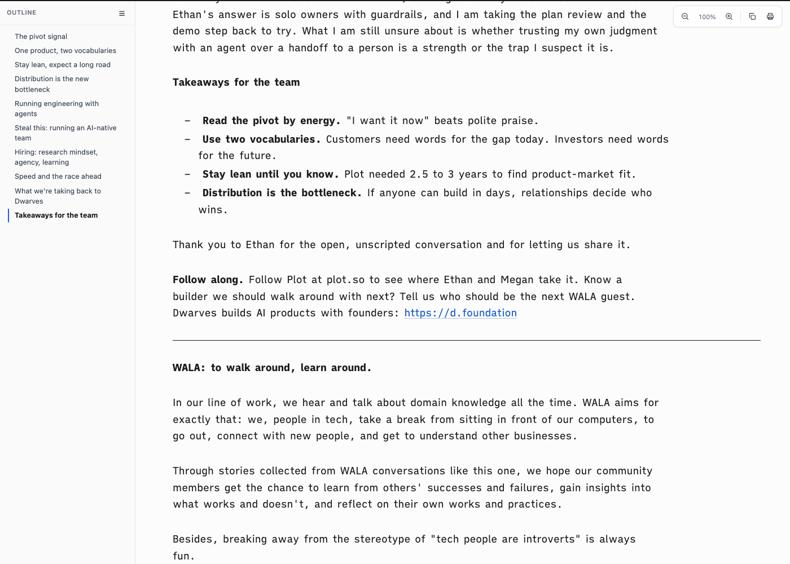
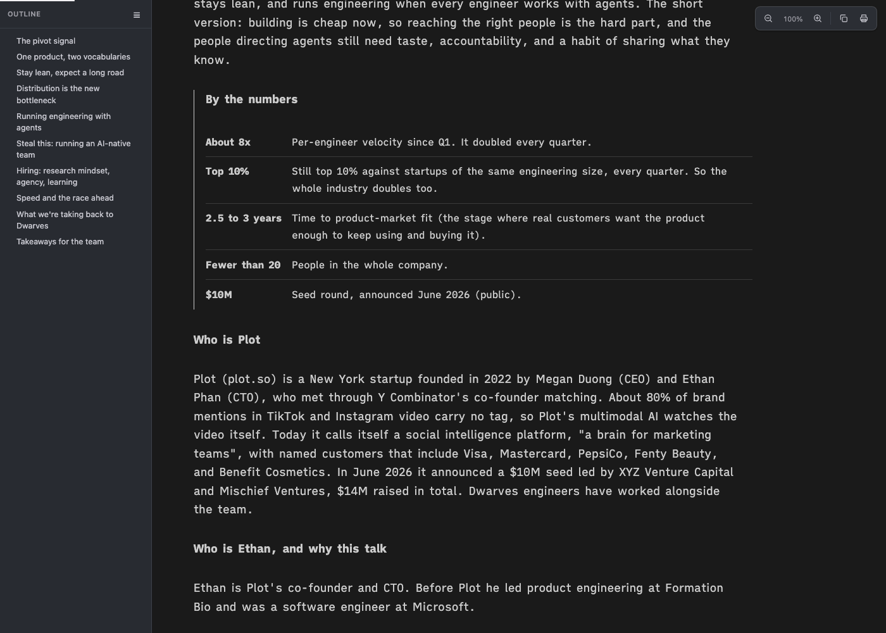
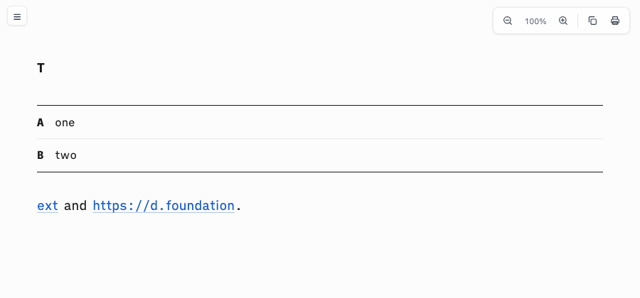
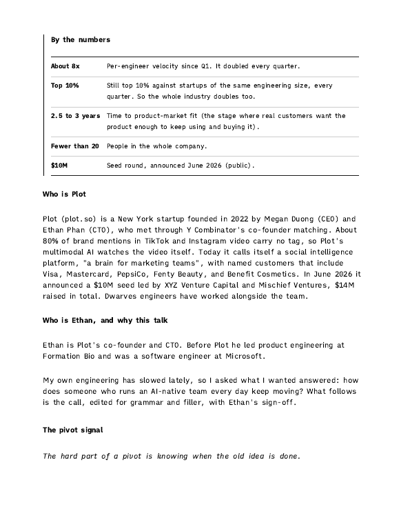
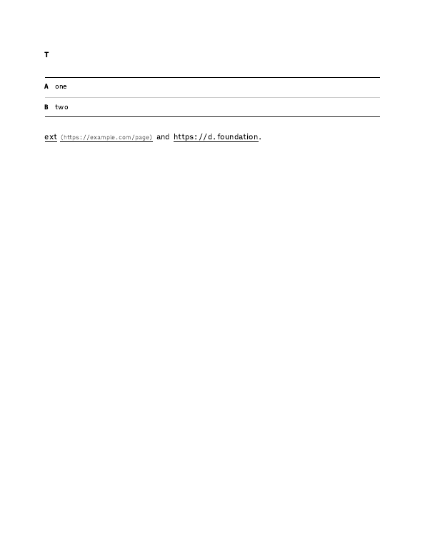

# Proof of Done, reading-chrome-polish

The browser and Safari reading view gets a polish pass: a clean outline sidebar with a reading-progress bar, calmer ia tables, local images embedded as data URIs (the Air reads pages served from the Mini), bare URLs as accent links, a print stylesheet with a Print button, and a labelled icon toolbar.

**Lane:** normal · **Host:** Mac-mini-2 · **Branch:** `feat/reading-chrome-polish`

## Green run

```
Command: bash tests/smoke.sh
Exit: 0
Output:
[polish-3] a local image becomes a data: URI, unless SPACEDOWN_EMBED_IMAGES=0
  ok: relative and absolute svg embedded; a 5 MB+ file and a remote URL left alone (logged once)
  ok: SPACEDOWN_EMBED_IMAGES=0 keeps the path
[polish-4] a bare URL becomes a link; the ia theme styles links as links
  ok: bare URL autolinked; accent, dark accent and focus ring present
[polish-5] print: button, stylesheet, chrome hidden, link addresses
  ok: print button wired; print sheet hides chrome, shows link addresses, keeps blocks whole
[polish-6] toolbar buttons carry an aria-label and a title; the progress bar exists
  ok: zoom out, zoom level, zoom in, copy and print are labelled icon buttons; progress bar present

smoke: all 67 passed
Verdict: PASS
```

## Negative control

Three controls through `negctl.sh`, each from a clean committed tree: green, mutate, red, restore, green.

| Mutation | Red check | Result |
|---|---|---|
| remove `+autolink_bare_uris` from `bin/spacedown` | `[polish-4]` FAIL, 66 passed 1 FAILED | Verdict: PASS |
| default `SPACEDOWN_EMBED_IMAGES` to `0` in `bin/spacedown` | `[polish-3]` and the synthetic fixture check FAIL, 65 passed 2 FAILED | Verdict: PASS |
| unscope the dash selector in `assets/ia-theme.css` (`ul > li::before`) | `[polish-1]` FAIL, 66 passed 1 FAILED | Verdict: PASS |

```
Command: negctl.sh <worktree> "bash tests/smoke.sh" "sed -i '' 's/+autolink_bare_uris//' bin/spacedown"
Exit: 0
Output:
Exit: 0 (green before mutation)
  smoke: all 67 passed
Mutation: sed -i '' 's/+autolink_bare_uris//' bin/spacedown
Changed: bin/spacedown
Exit: 1 (under mutation, RED expected)
  [polish-4] a bare URL becomes a link; the ia theme styles links as links
    FAIL: bare URL not linked or link styling missing
  smoke: 66 passed, 1 FAILED
Restore: git checkout HEAD -- bin/spacedown
Exit: 0 (green after restore)
Verdict: PASS
```

The other two controls print the same block with their own mutation line and the same `Verdict: PASS`.

## What it looks like

The test document is the WALA #5 article (frontmatter table, a headerless table in a blockquote, an SVG figure, a bare URL). Rendered with `bin/spacedown <md> --no-open --out <html>` and shot in a private headless Helium at 1400x1000.

| Shot | What it shows |
|---|---|
|  | System-font outline with no stray dashes, icon toolbar, bold first column, light row rules |
|  | The SVG figure embedded at column width, the 2px progress bar across the top |
|  | Accent bar on the active outline row, the bare URL as a link |
|  | Dark palette: table dividers, outline, toolbar |
|  | A table with an injected empty header row opens on its first body row under one ink rule |
|  | Print page 2: no chrome, black on white, table kept whole |
|  | Print: the address after an external link, none after a bare URL |

## Notes

- pandoc 3.11 already drops an empty `| | |` header row, so the empty-thead rule is a guard for older pandoc builds. Shot 05 injects the empty `<thead>` by hand to prove the rule.
- Images over 5 MB stay as written and log once on stderr.
- The first-column nowrap yields to wrapping in `.sd-wide` tables (prose columns).

## Rollback

Revert the branch's commits (or the squash commit): pages return to dash-bulleted outline, text toolbar and path-referenced images. `SPACEDOWN_EMBED_IMAGES=0` restores path-referenced images without a revert.
