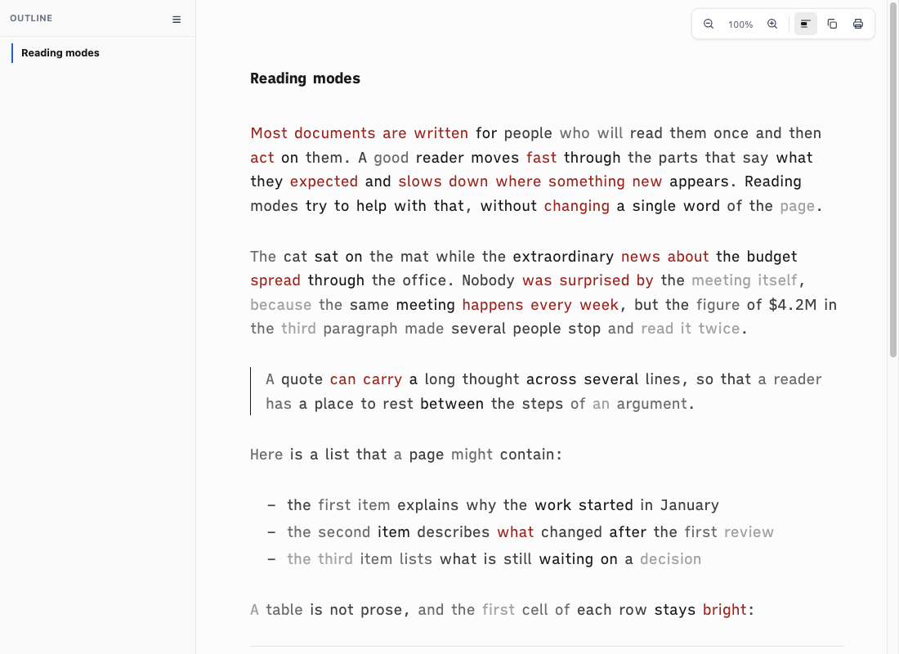
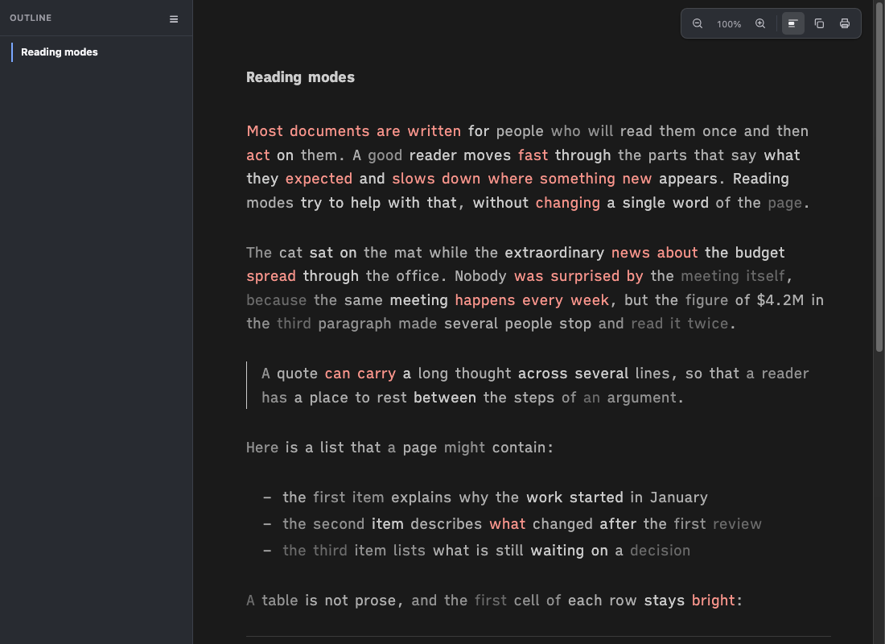
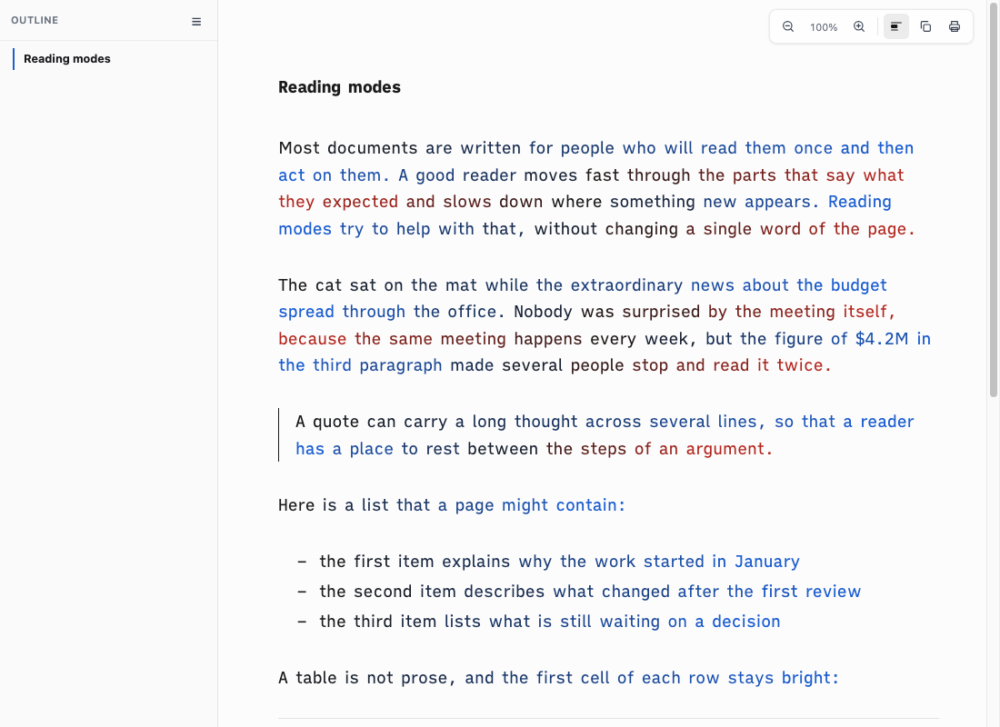
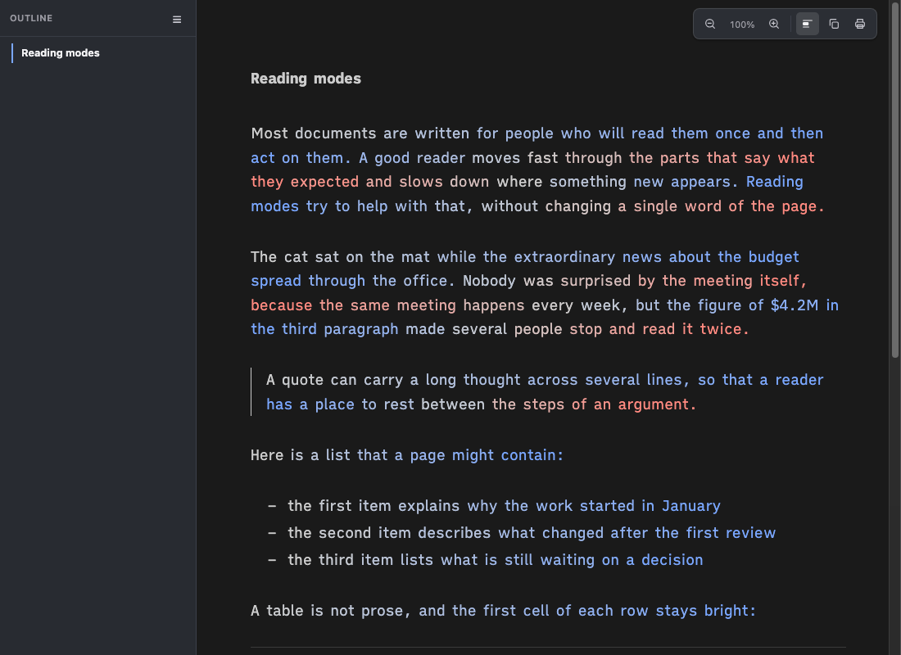
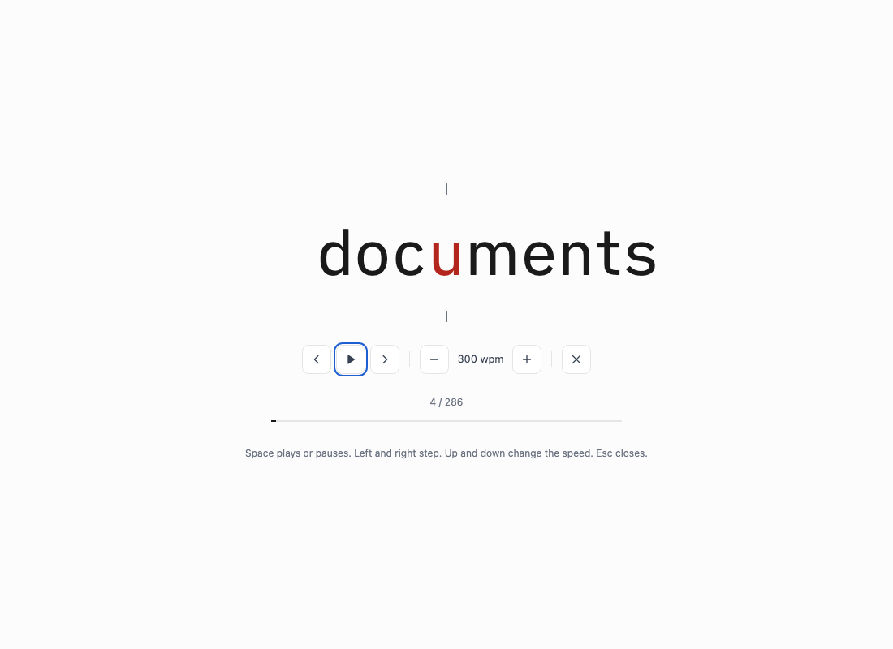
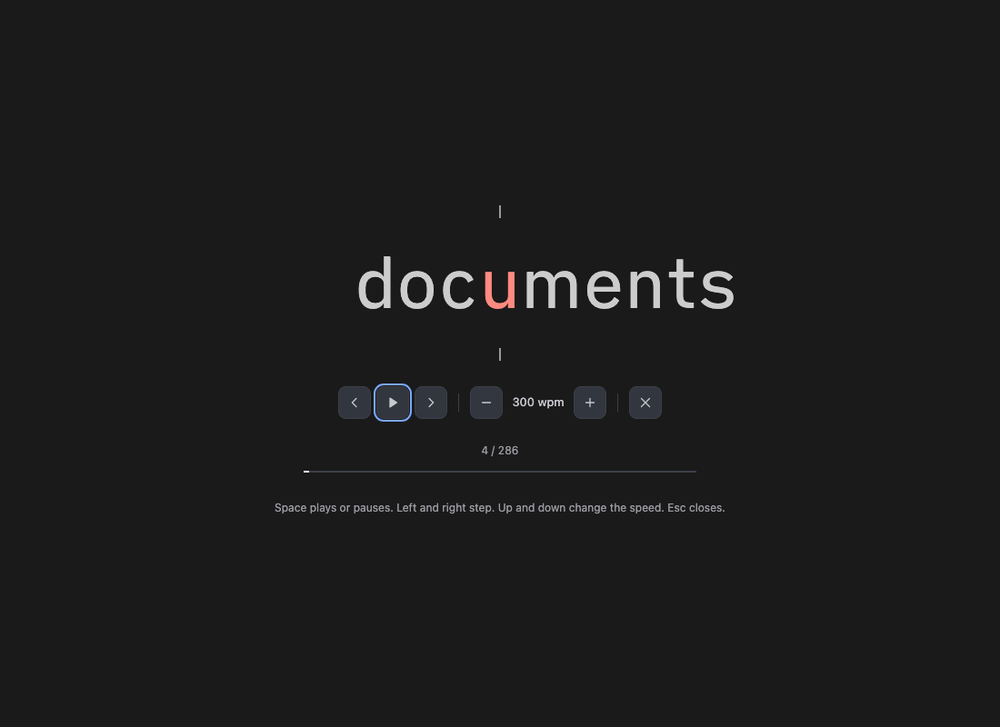
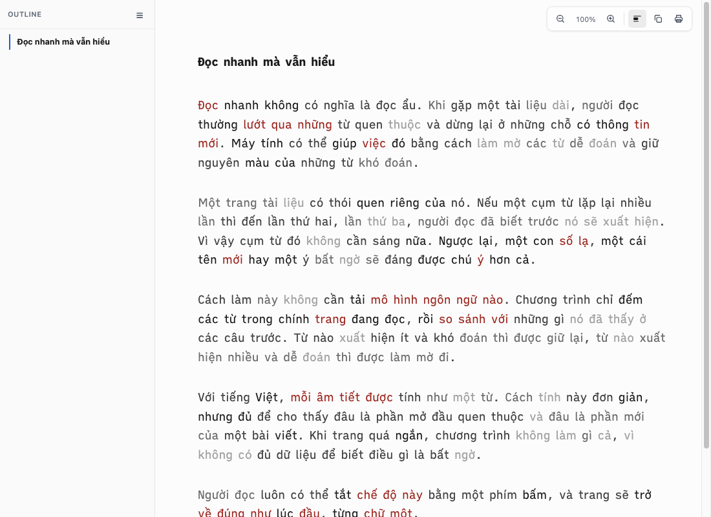
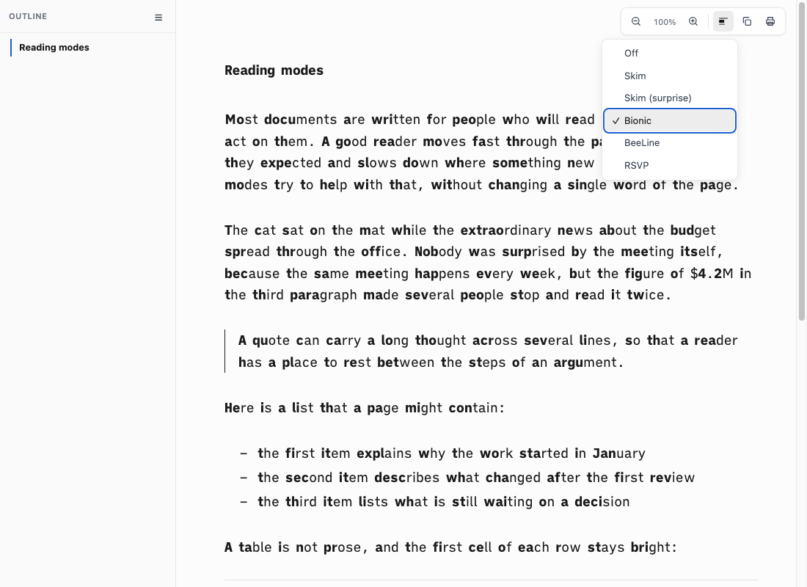
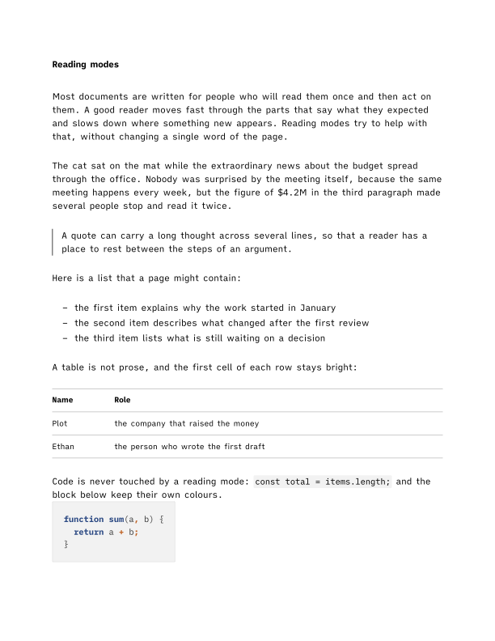

# Proof of Done, reading-modes

The single Skim toggle becomes one **Read** menu in the toolbar: Off, Skim, Skim (surprise), Bionic, BeeLine, RSVP. Exactly one mode is active. The `S` key turns the last-used mode on or off. The current mode is saved like the outline state, except RSVP: a reload must not open an overlay, so RSVP is remembered only as the last mode used. Every mode is screen only; print renders the normal page. The Quick Look render path does not load the reading chrome and is untouched.

| Mode | What it does | Where it lives |
|---|---|---|
| Skim | Unchanged: fades non-key words by colour | `assets/reading-chrome-head.html` section 7, key-word pass in the foot |
| Skim (surprise) | Port of the skimgram scoring core: five levels per word, `sd-s-2` to `sd-s2`, by colour | `assets/skim-surprise.html` (engine), foot (walk and paint), head section 8 (colours) |
| Bionic | Bolds the first 45% of each word (1 to 3 letters: 1 letter) in `b.sd-bi` | foot |
| BeeLine | One span per word, colour by x position in its rendered line, lines alternate so each starts on the colour the last ended on | foot (layout), head (colour) |
| RSVP | Overlay, one word at a time, recognition letter at 35% in red on a centre marker | foot (logic), head (overlay) |

## Green run

| Command | Exit | Verdict |
|---|---|---|
| `bash tests/smoke.sh` | 0 | PASS, 107 checks |

```
[skim-1] the toolbar has one Read menu button (menu-button ARIA, radio items) in place of the Skim toggle
[skim-4] the mode is a switch: data-sd-read-mode plus one sd-<mode> class, saved like the outline state
[read-1] the surprise engine ships as a partial, loaded before the chrome script, and is bundled
[read-2] skimgram is credited: MIT, its copyright line, in the partial and in THIRD_PARTY_NOTICES.md
[read-3] the scorer port: NFC keys, page-only model for non-English, short and flat pages left unscored
[read-4] every mode rule sits inside @media screen; print only hides the RSVP overlay; no opacity
[read-5] every theme carries the reading-mode tokens, and the chrome carries light and dark fallbacks
[read-6] turning a mode off puts the original text nodes back (no innerHTML round trip)
[read-7] one Read menu replaces the Skim button: six items, menu-button ARIA, keyboard open, move, close
[read-8] Skim (rules) from the menu: sd-skim only, key words stay bright, saved, S turns the last mode off and on
[read-9] Skim (surprise) on English: all five levels land on prose only, brighter and fainter words differ, no stacking
[read-10] Skim (surprise) on Vietnamese scores on the page alone; a tiny page is left unscored and says so
[read-11] Bionic bolds the start of each word (45%, at least 1, short words 1), Unicode aware, prose only
[read-12] BeeLine colours each line: ink to blue, then blue to ink to red, each line starting on the colour the last one ended on
[read-13] RSVP: dialog overlay, recognition letter near 35%, Space pauses, arrows step and change speed, Esc closes and exits
[read-14] switching through every mode never stacks markup; Off restores the original text exactly; S brings the last mode back
smoke: all 107 passed
```

Checks `read-7` to `read-14` are behaviour, not strings. `tests/smoke.sh` renders three fixtures (`tests/fixture/reading-en.md`, `reading-vi.md`, `reading-tiny.md`), inlines `tests/reading-modes-driver.js`, opens each page in a headless Chromium-family browser and reads the driver's JSON. The driver uses the real UI: it clicks the Read button and its items and dispatches key events. Without a browser the group is skipped with a line saying so; `SPACEDOWN_TEST_BROWSER` names one.

## What the driver measured

Headless Helium, 1000 by 500 window, `ia` theme.

| Fixture | Scored | Language path | Level spans (`-2`, `-1`, `1`, `2`) | Bionic bolds | BeeLine words, lines in last paragraph | RSVP words |
|---|---|---|---|---|---|---|
| `reading-en` (English, about 280 words) | yes | English prior kept | 33, 50, 50, 33 | 276 | 276, 7 | 286 |
| `reading-vi` (Vietnamese, about 270 words) | yes | page-only, lambda 0 | 162 spans in all | 268 | 269, 5 | 273 |
| `reading-tiny` (15 words) | no, "page is too short to score" | not reached | 0 | 15 | 15, 0 | 16 |

Other facts the driver asserts on the English fixture:

| Check | Result |
|---|---|
| Spans inside `pre`, `code`, `a`, `strong`, `h1`, `th`, the frontmatter table | 0 for surprise, bionic and BeeLine |
| A second surprise pass after switching away and back | same span count, no stacking |
| BeeLine first word colour vs the paragraph ink | within 0.0001 of a channel unit |
| BeeLine end of line N vs start of line N+1 | 0 channel difference on every line pair |
| RSVP recognition letter for `Reading` (7 letters) | index 2, `floor(7 * 0.35)` |
| RSVP speed | 300, Up gives 325, Down twice gives 275 |
| RSVP words from code or the link and bold text | no `const` or `return`; `project page,` and `bold text stays bold` present |
| RSVP start with the page scrolled to the end vs the top | `Links` vs `Reading` |
| Off after cycling surprise, bionic, BeeLine, Skim | text and text-node count equal to the load state, zero leftover spans |

## Language detection

The engine counts the share of word tokens found in the English list and the share carrying Vietnamese diacritics (decomposed marks and the stroke d). A page is English when the first is at least 0.35 and the second is below 0.10. Otherwise lambda is 0 and the page is scored on its own statistics. A page with more CJK characters than words keeps the character prior.

| Document | English share | Vietnamese share | Path |
|---|---|---|---|
| `tests/fixture/reading-en.md` | 0.88 | 0.00 | English prior |
| `research/2026-09-08-industrial-revolutions-displacement-and-middle-class.md` | 0.71 | 0.00 | English prior |
| `.claude/memory/agent-scope-change-update-or-replace.md` | 0.78 | 0.00 | English prior |
| `tests/fixture/reading-vi.md` | 0.01 | 0.93 | page-only |
| `learning/sales/courses/voices-of-sales/Day-04-explained.md` | 0.03 | 0.85 | page-only |

Identifier-heavy English technical pages can score 0.43 to 0.50, which is why the cut is 0.35 and not 0.55 (a first cut at 0.55 sent two of them to page-only). A wrong call only changes how the prior is weighted; it never breaks the page.

## Cost

Time from click to finished, headless Helium, whole page in one document.

| Page | Words | Skim | Surprise | Bionic | BeeLine | RSVP open |
|---|---|---|---|---|---|---|
| English research note | about 9600 | 13 ms | 48 ms | 45 ms | 81 ms | 19 ms |
| Vietnamese lesson | about 11700 | 13 ms | 59 ms | 56 ms | 106 ms | 19 ms |

BeeLine works per word, not per character, and reads every `offsetTop` and `offsetLeft` before it writes any style, so it lays out once.

## Visual check

Headless Helium, 1100 by 800, `ia` theme, English fixture. The dark palette is applied by promoting the `prefers-color-scheme: dark` blocks to `all`, since headless Helium does not report a dark scheme.

| | Light | Dark |
|---|---|---|
| Skim (surprise) |  |  |
| BeeLine |  |  |
| RSVP, paused on word 4 |  |  |

Skim (surprise) on the Vietnamese fixture, page-only path:



Bionic with the Read menu open:



Print, with Bionic saved as the mode (`--print-to-pdf`): normal weights, no toolbar, no overlay. The BeeLine page rendered to a PNG within one byte of this size, so print is the same page.



## Negative control

Run after the feature commits, each restored with `git checkout --` and the suite re-run green (`smoke: all 107 passed`).

| Break | Checks that went red | Result line |
|---|---|---|
| Remove the `--include-after-body "$SKIM_SURPRISE"` line from `bin/spacedown` | `read-1`, `read-7`, `read-9`, `read-10` | `smoke: 103 passed, 4 FAILED` |
| Remove the `insertBefore(u.orig, first)` line from `restoreText` in `assets/reading-chrome-foot.html` | `read-6`, `read-10`, `read-11`, `read-12`, `read-13`, `read-14` | `smoke: 101 passed, 6 FAILED` |

```
  FAIL: assets/skim-surprise.html missing, not injected before the chrome script, or not ASCII
  FAIL: Read menu structure or keyboard behaviour wrong
  FAIL: surprise mode did not score the English fixture as expected
  FAIL: non-English or tiny page handled wrongly
smoke: 103 passed, 4 FAILED
```

## Reproduce

```bash
bash tests/smoke.sh                      # whole suite; the behaviour checks need a Chromium-family browser
SPACEDOWN_TEST_BROWSER="/Applications/Google Chrome.app/Contents/MacOS/Google Chrome" bash tests/smoke.sh
./bin/spacedown some.md --out /tmp/some.html --no-open && open /tmp/some.html   # then use the Read button, or press S
```

## Known limits

- RSVP reads headings and keeps link and bold text; the other three prose modes skip links, bold, headings and the first table cell, as Skim does.
- BeeLine assumes left to right text.
- The two word lists come from `most-common-words-by-language` and `hanzi` (see `THIRD_PARTY_NOTICES.md`); the licences of the lists those packages draw on were not audited here.
- The scorer cannot tell a loanword from a native word, so an English term in a Vietnamese page is scored on the page's own counts like any other token.

## Rollback

Revert the commits of this branch. Nothing is stored server side; saved `sd-read-mode`, `sd-read-last` and `sd-rsvp-wpm` values in localStorage are ignored once the chrome no longer reads them, and an old `skim` value still means Skim.
