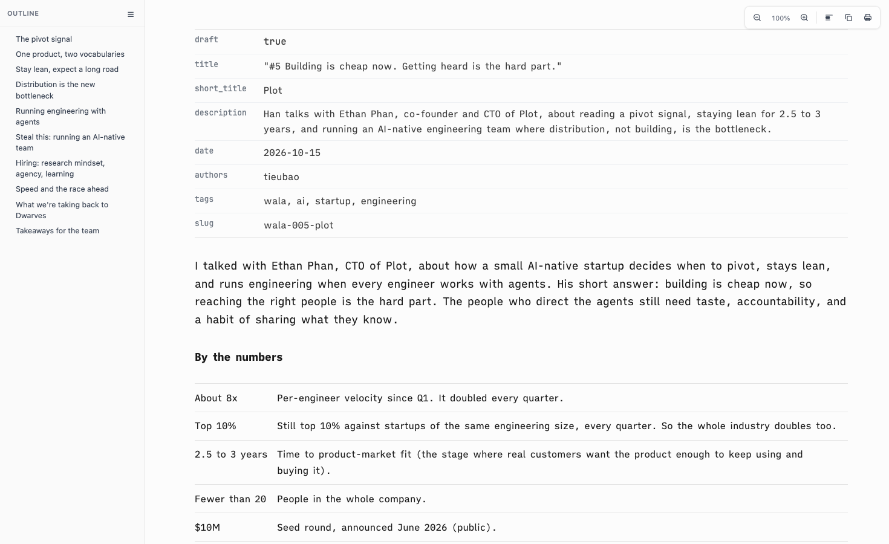
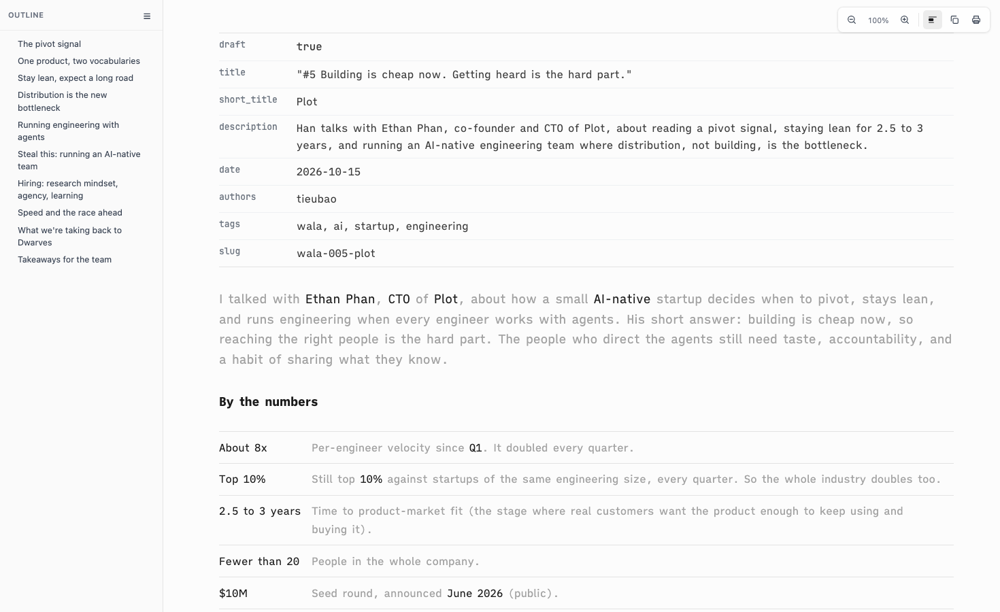
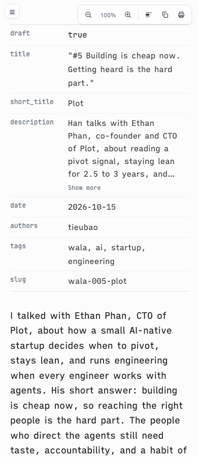
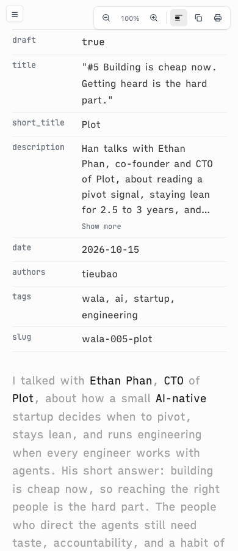
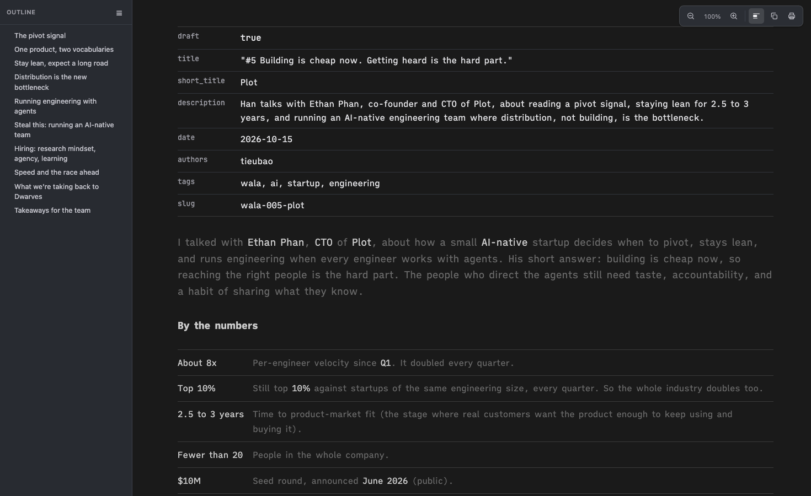
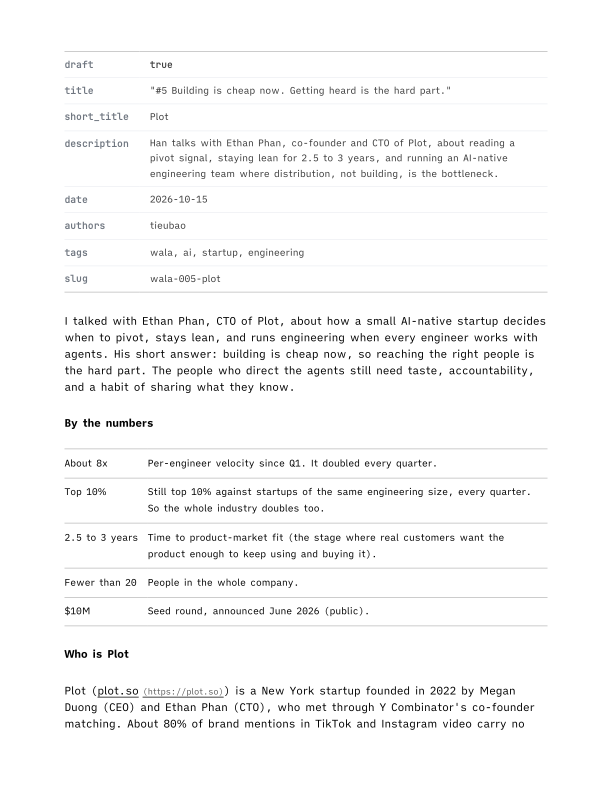

# Proof of Done, skim-mode

> Retired. The rules-based Skim described here was removed; the Read menu now has one Skim, the scored one (`skim-parity.md`). This page stays as the record of the first version.

A "Skim" toolbar toggle in the reading chrome. In skim mode the key words keep full ink and every other word fades to a soft grey, so a reader can skim. Rules only, no model. Key words: bold text, headings, table headers and the first cell of each row (CSS only), plus figures, acronyms and capitalized names found by a load-time pass that wraps them in `span.sd-key`. The mode is one `data-sd-read-mode` value with a matching `html.sd-skim` class, saved in localStorage, so a later exclusive mode can slot in beside it. The Quick Look render path does not load the reading chrome and is untouched.

## Green run

| Command | Exit | Verdict |
|---|---|---|
| `bash tests/smoke.sh` | 0 | PASS |

```
[skim-1] the toolbar gets a labelled Skim toggle with aria-pressed, beside zoom, copy and print
  ok: Skim button injected, pressed state styled
[skim-2] the CSS mode: faded color (not opacity), key words keep the ink, 150ms ease, motion-safe
  ok: fade by color, ink on key words, transition gated on no-preference
[skim-3] the faded color is a token in every theme, light and dark
  ok: ia, tm, paper and the read/mono fallback define light and dark fade tokens
[skim-4] the mode is a switch: data-sd-read-mode plus one sd-<mode> class, saved like the outline state
  ok: one mode at a time, persisted inside try/catch
[skim-5] the load-time pass wraps figures, acronyms and proper nouns in span.sd-key and skips code, links, math, frontmatter
  ok: key-word pass present and run at load
[skim-6] print renders the normal view: every skim rule sits inside @media screen
  ok: no skim rule outside a screen-only block (3 rules inside)
smoke: all 93 passed
```

## Bright-word share

Measured in headless Helium on the WALA #5 article (`brand/content/wala/005-plot/article.md`), skim on, after the 150ms fade settled. A word counts as bright when its element's computed color is not the faded color. Body words exclude the frontmatter table, code blocks, the outline and the toolbar.

| Font mode | Body words | Bright | Share |
|---|---|---|---|
| ia | 2203 | 248 | 11.3% |
| tm | 2203 | 245 | 11.1% |
| paper | 2203 | 260 | 11.8% |
| read | 2203 | 248 | 11.3% |
| mono | 2203 | 248 | 11.3% |

Where the 248 bright words in `ia` come from:

| Source | Words | Share of body |
|---|---|---|
| Bold text (`strong`, `b`) | 109 | 4.9% |
| Headings | 48 | 2.2% |
| First cell of each table row | 12 | 0.5% |
| Figures (`8x`, `10%`, `$10M`, `Q1`, `2026`) | 27 | 1.2% |
| Capitalized names | 37 | 1.7% |
| Acronyms (CTO, CEO, LLM) | 12 | 0.5% |
| Links (kept in their link color) | 3 | 0.1% |

Tuning notes:

- Without the once-per-section rule for names and acronyms, the share was 11.7% but "Plot" and "AI" lit up on most paragraphs. With it, 11.3%, and each name marks where it enters a section. One rule changed, one round.
- Sentence-initial capitals are not names. A name that opens a sentence ("Ethan said") stays faded; "Y Combinator" shows "Combinator's" bright and "Y" faded, because a single capital letter is never a name.
- In `paper`, a figure caption keeps the theme's own muted color (12 words), which is already a soft grey.

## Visual check

Headless Helium, WALA #5 article, `ia` mode. Skim on is the real path: localStorage preseeded, so the saved state, the pressed button and the key-word pass all run.

| | Skim off | Skim on |
|---|---|---|
| 1470px |  |  |
| 390px |  |  |

Dark, skim on (the dark palette applied by promoting the `prefers-color-scheme: dark` blocks to `all`, since headless Helium does not report a dark scheme):



Print, with skim saved as on (`--print-to-pdf`): black on white, no grey, no toolbar.



What the shots show: the frontmatter table stays at its own colors; headings, bold text, table first cells and figures stay at full ink; the toolbar button shows its pressed state; at 390px the toolbar fits and the text wraps normally.

## Negative control

The prior `assets/reading-chrome-head.html`, `assets/reading-chrome-foot.html` and the three theme files restored over the feature, same suite:

```
  FAIL: Skim toolbar button missing
  FAIL: Skim CSS rules missing or fade done with opacity
  FAIL: a theme lacks its skim tokens
  FAIL: read-mode switch or its persistence missing
  FAIL: key-word pass missing
  FAIL: a skim rule can reach print (0 outside @media screen of 0)
smoke: 87 passed, 6 FAILED
```

## Rollback

Revert this squash commit. Nothing is stored server side; a saved `sd-read-mode` value in localStorage is ignored once the chrome no longer reads it.
