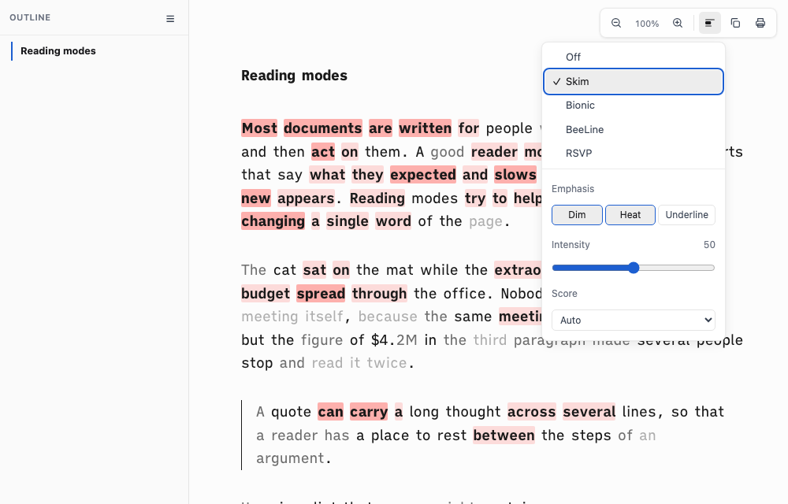
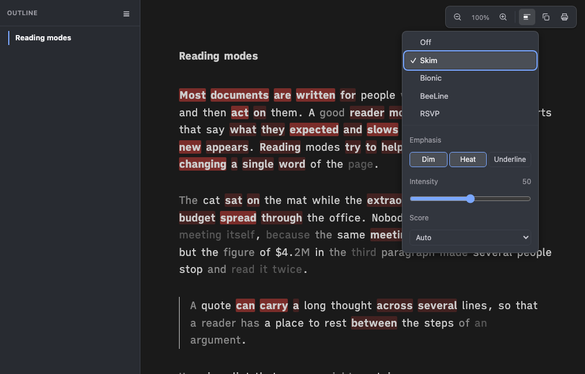

# Proof of Done, skim-parity

The Read menu had two Skims: a rules-based one and a port of the skimgram scorer called Skim (surprise). There is now one, named Skim, and it is the scorer. The port is checked against skimgram at commit `4ebb78a` (MIT, AwesomeDog, 2026-09-18) token by token, and it paints with skimgram's own emphasis styles and settings. The Quick Look render path does not load the reading chrome and is untouched.

| Change | Where it lives |
|---|---|
| Rules-based Skim removed: key-word pass, `.sd-key`, the colour fade, the fade tokens in `ia`, `tm`, `paper` and the chrome | `assets/reading-chrome-foot.html`, `assets/reading-chrome-head.html`, the three theme files |
| Menu is Off, Skim, Bionic, BeeLine, RSVP; a saved `surprise` or old `skim` value opens the new Skim; `S` toggles the last mode, Skim by default | foot |
| Engine aligned with upstream: basis option, flattening with the 400k cap, skip reasons, CJK rank lookup, language rule | `assets/skim-surprise.html` |
| Emphasis (Dim, Heat, Underline), Intensity, Score, shown under the menu while Skim is on, saved in `localStorage` | foot (panel), head (values and panel styles) |
| Parity script, eleven fixtures, goldens made from upstream | `scripts/skim-parity.mjs`, `tests/fixtures/skim/` |

## Green run

| Command | Exit | Verdict |
|---|---|---|
| `bash tests/smoke.sh` | 0 | PASS, 114 checks |
| `node scripts/skim-parity.mjs` | 0 | PASS, port against the committed goldens, 0.4 s |
| `node scripts/skim-parity.mjs --upstream <clone> --freq-dir <dir>` | 0 | PASS, port against skimgram run live |

The live run, upstream `4ebb78a`, word lists from `most-common-words-by-language` 3.0.14 and `hanzi` 3.2.0. Each fixture is scored under basis auto, surprisal and gain, and intensity 0, 25, 50 and 100 (12 runs). Per token it compares key, kind, offsets, level, raw score and smoothed score. Scores must agree to 1e-9; the live run measured a largest difference of 0.

| Fixture | What it is | Tokens (port) | Tokens (upstream) | Sequence | Scored | Path | Mismatched tokens |
|---|---|---|---|---|---|---|---|
| `en-long` | Alice, from the first page on | 12030 | 12030 | 6643 | 5340 | English prior | 0 |
| `en-medium` | Alice, the Caterpillar scene | 1415 | 1415 | 820 | 587 | English prior | 0 |
| `en-short` | Alice, later in the Caterpillar scene | 813 | 813 | 450 | 363 | English prior | 0 |
| `en-599` | Alice, the Cat's directions, cut at 599 sequence tokens | 1036 | 1036 | 599 | 435 | English prior | 0 |
| `en-600` | the same text cut at 600 | 1037 | 1037 | 600 | 436 | English prior | 0 |
| `code-mixed` | English with identifiers, paths, flags, versions | 1053 | 1053 | 640 | 438 | English prior | 0 |
| `identifiers` | an API listing, 31% common English words | 1380 | 1380 | 1015 | 358 | English prior | 0 |
| `cjk` | Chinese prose with fullwidth letters and digits | 1036 | 1036 | 1026 | 918 | character prior | 0 |
| `flat` | one sentence repeated, upstream calls it flat | 520 | 520 | 280 | 240 | English prior | 0 |
| `numbers` | 120 numbers, nothing to score | 240 | 240 | 120 | skipped | n/a | 0 |
| `tiny` | 40 tokens, under minTokens | 70 | 70 | 40 | skipped | n/a | 0 |

Total: 0 mismatched tokens over 11 fixtures, 0 token count differences. The Alice text is public domain (Project Gutenberg #11, Lewis Carroll, with each typographic dash written as two hyphens); the Chinese, code and identifier texts were written for this test.

| Boundary | Fixture | Result on both sides |
|---|---|---|
| Gain switch, `>= 600` sequence tokens | `en-599`, `en-600` | surprisal at 599, gain at 600 |
| Lambda plateaus (0.55 up to 400, 0.08 from 6000) and the slide between | `en-short` (450), `en-medium` (820), `en-long` (6643) | same scores |
| Skip: too short, too few scoreable, flat | `tiny`, `numbers`, `flat` | same three reasons |
| CJK per character, fullwidth to NFKC | `cjk` | same tokens and keys |
| Page flattening, separator between every text node, 400k cap | four synthetic pages built from `en-long` | same runs, length, text hash and offsets, including an offset of exactly 400000 and one of 399999 |
| Word lists | `EN_WORDS`, `CJK_CHARS` | 3000 and 2000 entries, equal to the lists built from the two packages |

The goldens in `tests/fixtures/skim/golden/` hold scores to 12 significant digits, so a golden run reports a largest difference near 5e-11. The smoke check `parity-1` runs them with no upstream clone; `parity-2` fails if a golden stops reaching a boundary above.

## What differed in the first port, and what was done

| Where | Before | Now | Evidence |
|---|---|---|---|
| Language rule | Any page with under 35% common English words dropped the English prior | Page-only needs non-ASCII evidence (see deviations) | With the old rule `identifiers` (31% common words) went page-only: 1380 mismatched tokens, 3.10 bits largest score difference |
| Score basis | Not an option (always auto) | `basis` option: auto, surprisal, gain | the `surprisal` and `gain` columns of the 12 runs |
| Flattening | Separator only between blocks, no cap | Separator between every text node, cut at 400000 characters, as upstream's walker | four flatten cases |
| Skip reasons | "page is too short to score", "not enough words to score" | upstream's three texts | `parity-2` |
| CJK lookup | any key, indexed with `Array.from` | only one-character keys, indexed by UTF-16 unit, as upstream | same results (every entry in the list is in the BMP), now the same code |
| Painting | Colour fade, level 0 held back from the ink, no settings | skimgram's dim, heat, underline and the three settings | next table |

Compared line by line and found equal, no change: tokenizer (CJK ranges, fullwidth range, word characters, trailing apostrophe and hyphen rule), n-gram model (order 4, strength 2, minimum context 2, context joining), percentile rank with mean rank ties, the 3-point smoothing kernel, IQR with quartile index `floor(p * n)`, quantisation cut-offs, Zipf prior with the out-of-vocabulary floor, probability floor 1e-7, mixing and the gain formula.

| Constant | skimgram | Port |
|---|---|---|
| n-gram order, strength, minimum context | 4, 2, 2 | 4, 2, 2 |
| Blend weight | 0.55 up to 400 tokens, 0.08 from 6000, log interpolation between | same |
| Gain switch | 600 | 600 |
| Smoothing kernel | 0.5, 0.3, 0.2 | same |
| Flat page cut-off | IQR under 0.25 bits | same |
| Quantisation | 5 levels, `outer = 0.5 - 0.24 k`, `inner = 0.5 - 0.6 k`, `k = intensity / 100`, 0 marks nothing | same |
| Minimum tokens | 80 | 80 |
| Character cap | 400000 | 400000 |
| Probability floor | 1e-7 | 1e-7 |

## Rendering and settings

| Setting | skimgram | Port |
|---|---|---|
| Emphasis | Dim, Heat, Underline, any mix, default Dim and Heat | same mix, default Dim only (deviation 3), buttons with `aria-pressed`, `data-sd-skim` token list on `html` |
| Intensity | 0 to 100, step 5, default 50; moves the cut-offs, not the CSS | same |
| Score | Auto, Surprisal, Contextual gain, default Auto | same |
| Dim | opacity .62 and .34 for levels -1 and -2; weight 600 and 700 for levels 1 and 2 | same values |
| Heat | red `rgba(255, 71, 64)` at alpha .18 and .42, radius 2px | same values |
| Underline | 1px at level 1; 2px and weight 600 at level 2; offset 2px | same values |
| Theme | one red hue as alpha only, opacity for the fade, no per-theme colours | no theme token: alpha-only red and opacity read on a light and a dark ground, as upstream notes (dark shot below) |
| Print | n/a | every rule inside `@media screen`; checked by `skim-6` and `read-4` |
| Off | clear() puts the text back | `restoreText()` puts the original text nodes back; `read-14` and the settings check compare the page to its load state |

| Light | Dark |
|---|---|
|  |  |

The panel shows only while Skim is on. The seeded checks (`read-10c`) load a page with `surprise`, then `skim`, then saved settings in `localStorage` and read back an open Skim with the right emphasis, intensity and basis. Real pages through the worktree CLI, Skim on: the English research note gets 4094 spans, the Vietnamese lesson (page-only path) 6240, the short English note 152.

## Deviations from upstream

Deviations 1 and 2 can change a result only on input that is neither plain English nor CJK.

1. **NFC fold.** Token keys go through `normalize("NFC")` before lowercasing (upstream lowercases as is). NFC leaves ASCII and already composed text unchanged, so English and CJK pages are scored identically. It merges `e` plus a combining accent with the composed letter, which matters for Vietnamese typed either way.
2. **Page-only fallback.** A page that is not mostly CJK is scored with lambda 0 (no English prior, the page's own statistics only) in two cases: at least 10% of its words carry a Vietnamese-type mark once decomposed (grave, acute, circumflex, tilde, breve, hook, horn, dot below, stroke d), or fewer than 35% of its words are in the English list and at least 5% contain a non-ASCII letter (a curly apostrophe does not count). A page whose words are all ASCII is never page-only, so identifiers, paths and jargon cannot move it off the prior. Upstream has no such rule and always uses the prior.

3. **Default emphasis is Dim only** (skimgram defaults to Dim and Heat). A rendering default, not scoring: Heat and Underline stay in the settings panel, and the goldens are unchanged (`skim-dim-default.md`).

Not engine deviations, but a difference in what text is read: the DOM walk is spacedown's own. It scores the prose blocks (`p`, `li`, `td`, `blockquote`, `dd`, `figcaption`) and skips code, links, math, bold, headings, the first table cell, the frontmatter table and the chrome. Upstream reads every text node outside a fixed tag list. The parity script proves the engine and the flattening, not that choice.

## Negative control

Run after the feature commits. Each break was restored with `git checkout --` and the suite re-run green.

| Break | Result |
|---|---|
| `SMOOTH_KERNEL` last weight 0.2 to 0.25 in `assets/skim-surprise.html` | `skim-parity`: 20320 mismatched tokens, FAIL; `smoke: 113 passed, 1 FAILED` (`parity-1`) |
| `GAIN_MIN_TOKENS` 600 to 601 | 1037 mismatched tokens (all of `en-600`), FAIL |
| `MAX_CHARS` 400000 to 400001 | `flatten cap-exact-400000  runs 401  DIFFERS from upstream`, FAIL |
| `SMOOTHING` 2 to 3 | 20320 mismatched tokens, FAIL |
| `NON_ASCII_MIN` 0.05 to 0 (the first port's language rule) | 1380 mismatched tokens on `identifiers`, FAIL |
| `savedName` returns its argument in `assets/reading-chrome-foot.html` (no `surprise` mapping) | `smoke: 112 passed, 2 FAILED` (`skim-5`, `read-10c`) |

```
--- control: smoothing weight 0.2 -> 0.25
skim-parity: port against committed goldens from upstream skimgram 4ebb78a
20320 mismatched tokens over 11 fixtures, 0 flatten differences, 0 word list differences, 0 token count differences
skim-parity: FAIL
  FAIL: the port differs from the skimgram goldens
smoke: 113 passed, 1 FAILED
```

After `git checkout -- assets/skim-surprise.html`: `skim-parity: OK` and `smoke: all 114 passed`.

## Reproduce

```bash
bash tests/smoke.sh                       # the whole suite; parity-1 and parity-2 need node
node scripts/skim-parity.mjs              # port against the committed goldens
# against skimgram itself: a clone at 4ebb78a, plus the two word-list packages unpacked under <dir>/node_modules/
#   npm pack most-common-words-by-language@3.0.14 hanzi@3.2.0   (then unpack each to <dir>/node_modules/<name>/)
node scripts/skim-parity.mjs --upstream ~/src/skimgram --freq-dir <dir>
node scripts/skim-parity.mjs --upstream ~/src/skimgram --freq-dir <dir> --write-golden   # regenerate the goldens, then read the diff
```

The clone is read only: the script copies `src/core/*.ts` and `src/dom/walker.ts` to a temp directory, rewrites their import paths, adds one `debug` field to the copy of `scorer.ts` so the raw and smoothed scores can be read, and runs them with `node --experimental-strip-types`. Nothing in the clone is built or installed.

## Known limits

- The golden run needs node but no clone. The live run needs node 22 or later (type stripping), the clone and the two packages.
- Fixtures have no decomposed accents and no non-English prose, because deviations 1 and 2 are meant to differ there. The Vietnamese path is covered by the browser checks (`read-10`), not by parity.
- A non-English page written in ASCII only (for example Indonesian) keeps the English prior, as in skimgram. Before this change it went page-only.
- The word lists are the same data as upstream; the licences of the lists those packages draw on were not audited here (see `reading-modes.md`).

## Rollback

Revert the commits of this branch. After a revert a saved `skim` opens the rules-based Skim again and a saved `surprise` the scored one; the new `sd-skim-emph`, `sd-skim-intensity` and `sd-skim-basis` values are ignored by the old chrome.
