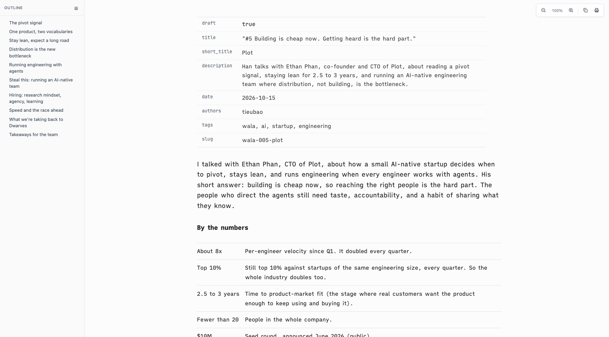
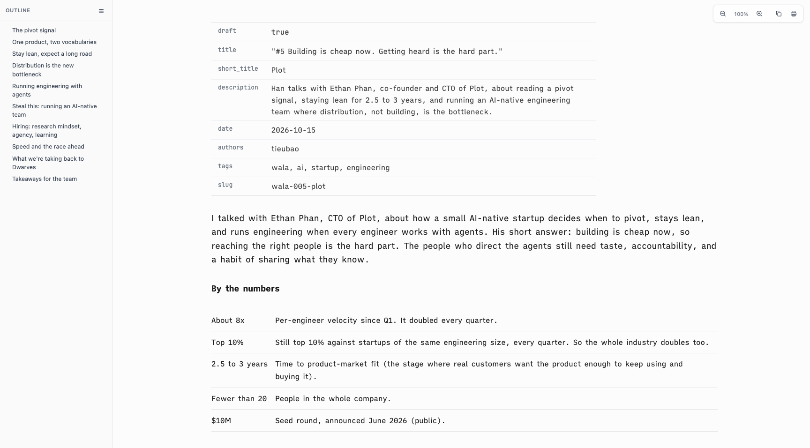

# Proof of Done, wide-reading-column

The owner wants a wider container, not a narrower page. The body goes back to 60rem, and prose, tables and section rules fill it instead of stopping at a 48rem measure. The column stays centered with one right edge. The column test also stops aborting the suite when its rule is missing: it now reports FAIL.

## Green run

| Command | Exit | Verdict |
|---|---|---|
| `bash tests/smoke.sh` | 0 | PASS |

```
[13] page column overrides pandoc default
  ok: 60rem column wins over pandoc 36em; prose fills it
smoke: all 85 passed
```

Content edges and the space beside them, headless Helium, WALA #5 article, no horizontal page scroll:

| window | 48rem column (before): content left-right, gap left / right | 60rem column (after): content left-right, gap left / right |
|---|---|---|
| 1470px | 419-1283, 179 / 165 | 311-1391, 71 / 57 |
| 1728px | 548-1412, 308 / 294 | 440-1520, 200 / 186 |

| before (1728px) | after (1728px) |
|---|---|
|  |  |

## Negative control

The prior `assets/vscode-preview-head.html` (48rem column) restored over the fix, same suite:

```
  FAIL: page column / prose measure missing or ordered before pandoc default
  FAIL: tables or rules run past the prose measure: the page has two right edges
smoke: 83 passed, 2 FAILED
```

## Rollback

Revert this squash commit to return to the 48rem column.
